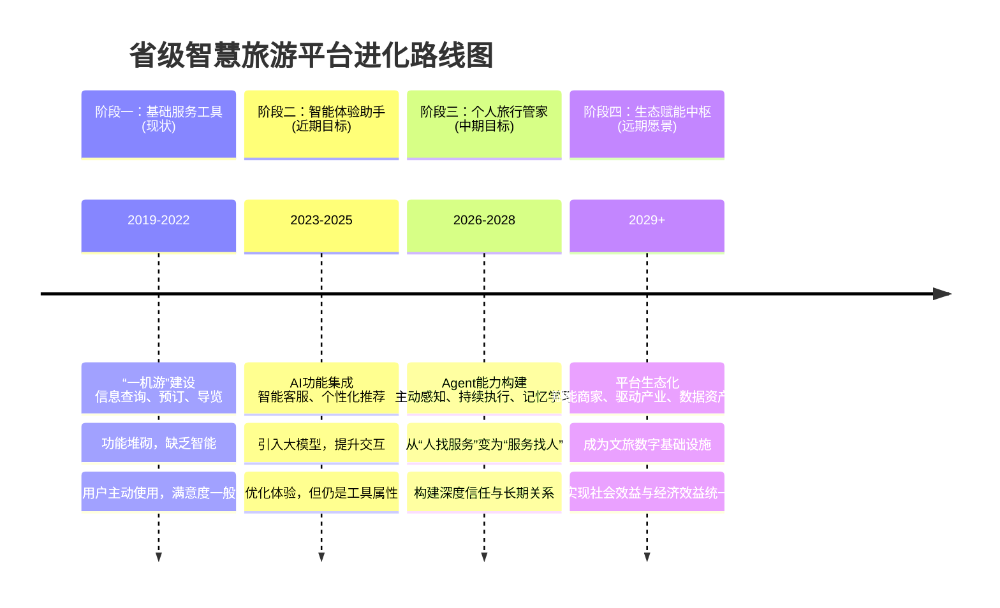

# Muse 对游安徽运营启示

Meta的Muse作为个人AI Agent的产品理念、技术架构和运营策略，对省级智慧旅游平台（如“游安徽”）的运营具有重要的启示。

它不仅仅是一个新的技术产品，更代表了一种从“工具”到“助理”、从“功能”到“体验”、从“平台”到“生态”的范式转变。

下面我将从多个维度为你解析Muse带来的启示，并提供具体的运营建议。

## 一、战略定位与核心价值：从“信息工具”到“个人旅行助理”

Muse的核心是“**个人超级智能**”，旨在成为用户的“第二大脑”和“私人代理”。这与当前智慧旅游平台主要作为“信息查询工具”的定位有本质区别。

**Muse的启示：**

- **超越“一机游”，追求“一机智”**：省级平台不应满足于成为一个功能丰富的“瑞士军刀”，而应致力于成为一位懂你、为你着想、能替你跑腿的“**私人旅行管家**”。
- **赋能游客，而非仅服务游客**：平台的核心价值不再是提供信息，而是**通过AI将游客从繁琐的行程规划、预订、信息比对中解放出来**，让他们能更专注于享受旅程本身。
- **构建长期关系，而非一次性交易**：通过AI的记忆能力，平台可以持续学习用户偏好，提供跨次、跨年的个性化服务，从而构建起**长期的、有情感连接的用户关系**，而不仅仅是单次旅游的交易关系。

**对“游安徽”的运营建议：**

1. **明确定位，聚焦核心场景**：清晰定义“游安徽”APP的AI助手角色，将其从“旅游信息库”升级为“**安徽旅行首席体验官**”。优先深耕**行程智能规划、实时个性化推荐、应急问题处理**等核心场景，做到极致，而非盲目追求功能数量。
2. **引入“代理”思维**：探索AI在**代客执行**层面的应用。例如：
    - **智能客服升级**：从问答机器人升级为“**客服代理**”，能理解复杂诉求，并**主动跟进、协调多方资源**解决游客问题（如处理退款、协调酒店换房）。
    - **“一键委托”**：允许用户将一系列需求（如“安排一个周末的亲子游，预算2000元，喜欢自然和科技”）委托给AI，由其生成方案并**辅助甚至代为完成预订**。

## 二、产品体验与交互设计：从“用户主动搜索”到“AI主动服务”

Muse强调**持续驻留、主动感知、执行任务**，其交互模式是“**用户赋予目标，AI持续工作**”。这颠覆了传统App“人找功能”的模式。

**Muse的启示：**

- **从“被动响应”到“主动预见”**：AI应能基于用户位置、时间、行程和偏好，**主动提供预警、建议和帮助**（如：“前方2公里处有拥堵，建议绕行”、“您预约的景点即将开园，现在是前往的最佳时间”）。
- **打造“神奇时刻”**：产品需要创造让用户愿意分享的“惊艳瞬间”。例如，AI通过分析游客照片，自动生成一份包含地点标注、旅行轨迹和个性化文案的Vlog，并可直接分享至社交平台。
- **建立“信任循环”**：每一次成功的任务执行都会增加用户对AI的信任，从而愿意赋予其更多权限，形成正向循环。**首次使用时的引导和“小成功”设计至关重要**。

**对“游安徽”的运营建议：**

1. **设计“旅程模式”**：在APP中提供一键开启的“**旅程管家**”模式。开启后，AI可整合行程、票务、天气、交通、实时客流等信息，并在锁屏界面以**简洁的卡片形式**提供关键信息和建议，减少用户频繁打开APP的次数。
2. **引入“情境感知”推送**：利用手机传感器（GPS、蓝牙）和后台数据，在**特定情境下触发服务**。例如：当用户进入某景区范围时，自动启动电子导览；当临近预订的餐厅时，提醒订单详情。
3. **创造“可分享的资产”**：鼓励用户通过平台生成**可分享的数字纪念品**，如个性化电子明信片、智能行程总结、旅行数据可视化报告（足迹图、消费图谱），并嵌入平台小程序码，实现社交传播与引流。

## 三、技术架构与信任构建：从“功能安全”到“可信基础设施”

Muse将**安全与信任视为产品基石**，而非附加功能。其架构设计（如机密虚拟机、凭证隔离、哨兵智能体）旨在从底层保障用户数据与操作安全。

**Muse的启示：**

- **透明化与可解释性**：AI的决策和建议过程对用户应尽可能**透明**，让用户知道“为什么给我推荐这个”，从而建立信任。
- **权限最小化与控制感**：用户应能**精细控制AI的权限**（如仅授权读取行程，不授权读取相册），并**明确知晓每次操作将带来的后果**。
- **技术即信任的保障**：强大的技术架构是安全承诺的支撑。省级平台需要构建**可信的数据处理与调用环境**。

**对“游安徽”的运营建议：**

1. **构建“安徽文旅可信数据空间”**：参考安徽省文化产权交易所的试点经验，推动建立**全省统一的、经授权的文旅数据共享与调用平台**。确保景区、酒店、交通等数据在安全合规的前提下为AI模型提供高质量“燃料”。
2. **引入“隐私计算”技术**：在数据不出域的前提下，实现数据价值挖掘。例如，通过联邦学习技术训练AI模型，既能利用全省数据优化模型，又能**从技术上保障原始数据不泄露**。
3. **设计“信任中心”**：在APP设置中开辟“**信任与隐私中心**”，用图文并茂的方式向用户清晰解释：
    - **数据如何被使用**：只用于优化服务，不用于商业倒卖。
    - **权限如何被控制**：每个功能需要哪些权限，如何管理。
    - **安全如何被保障**：采用哪些技术手段（如加密、脱敏）保护数据。

## 四、增长策略与生态构建：从“用户增长”到“生态繁荣”

Muse的增长策略强调**口碑传播**和**利用现有庞大渠道**（如 WhatsApp ）。这对拥有政府背景和渠道资源的省级平台极有借鉴意义。

**Muse的启示：**

- **利用“存量”带“增量”**：智慧平台可**深度融入本地的社交、支付、出行等生态**，而非孤立存在。例如，将服务嵌入微信小程序、支付宝市民中心，借助其巨大流量触达用户。
- **“内容”与“工具”双轮驱动**：通过**PGC/UGC内容**（攻略、游记、短视频）吸引用户，再用**强大的AI工具**提升其留存和活跃度。
- **赋能中小商家，共建生态**：平台不仅是C端用户的工具，也应成为B端商家（尤其是中小民宿、餐馆、文创店）的**数字化赋能平台**，为其提供简单的AI工具（如智能客服、营销文案生成），丰富平台供给，形成良性循环。

**对“游安徽”的运营建议：**

1. **深度融入“本地生活”生态**：
    - **小程序矩阵化**：将“游安徽”的核心功能（预约、导览、客服）以**微信小程序**的形式，嵌入到**城市服务、公交地铁、本地新闻**等小程序中，实现“**触点即服务**”。
    - **打通“安徽码”与社保卡**：加速推进“**卡码融合**”，实现**身份认证、优惠发放、权益核验、快捷支付**一码通用，极大提升便捷性和政府公信力。
2. **构建“内容+AI”的获客引擎**：
    - 与主流内容平台（小红书、抖音、B站）合作，推出“**安徽旅行灵感计划**”，鼓励用户创作内容，并**在内容中嵌入“游安徽”的AI行程规划工具**，实现从“看”到“行”的无缝转化。
3. **推出“商家AI赋能计划”**：
    - 为全省文旅商户提供**免费的、轻量级的SaaS工具**，如“**AI客服小皖**”（解答常见问题）、“**智能海报生成器**”（制作宣传物料），降低其数字化门槛，丰富平台服务生态。

## 五、运营模式与组织能力：从“项目制”到“产品化”

Muse的开发采用了**小团队、快节奏、以用户为中心**的迭代模式。这与许多智慧平台“一次性项目制”的建设思路不同。

**Muse的启示：**

- **“小步快跑，快速迭代”**：建立**持续运营**的团队和机制，根据用户反馈和数据表现，**每月甚至每周**对AI模型和功能进行微调，而非依赖数年一次的大版本更新。
- **“数据驱动决策”**：建立完善的**用户行为分析系统**，精准度量每个功能的使用率、留存率、满意度，用数据指导产品迭代方向。
- **“政企合作，专业运营”**：明确政府作为**规划者、监管者和数据提供方**的角色，引入**专业的互联网产品和技术公司**进行**联合运营**，发挥各自优势，提升平台的专业性和可持续性。

**对“游安徽”的运营建议：**

1. **组建“产品与运营联合团队”**：在省文旅厅的指导下，组建一支包含**产品经理、AI工程师、数据分析师、内容运营、商家运营**的联合团队，负责“游安徽”的日常迭代和增长。
2. **建立“数据驾驶舱”**：构建一个**实时可视化的数据大屏**，展示核心指标（如日活、AI使用频次、用户满意度NPS、商家接入数），让运营决策有据可依。
3. **试点“揭榜挂帅”机制**：针对特定场景（如“**研学旅行智能规划**”、“**古村落深度游推荐**”），**公开发布需求，征集解决方案**，与高校、企业或创业团队合作，激发创新。

## 智慧旅游平台进化路线图

为了更直观地展示从传统平台到“个人旅行助理”的演进路径，我为你梳理了一个关键阶段的路线图：

## 核心启示总结

Muse给“游安徽”乃至所有省级智慧旅游平台的**最大启示**在于：**未来的竞争不再是功能数量的竞争，而是深度体验和信任构建的竞争**。平台的核心价值将体现在其**AI的“智商”和“情商”**上——即是否能真正理解用户需求，是否能可靠地代表用户利益完成任务，是否能持续赢得用户的信任。

最终，智慧旅游平台的终极形态可能是一个**无形的、却无处不在的“数字孪生管家”**，它融入你旅行的每一个瞬间，在你需要时出现，在你不需要时隐退，默默为你打理好一切，让你能全身心地沉浸于安徽的山水人文之间。

这要求运营者**从“做功能”的思维，转向“做体验”和“做关系”的思维**，并为此投入相应的技术、人才和组织架构。这是一条更具挑战但也更有价值的路径。
