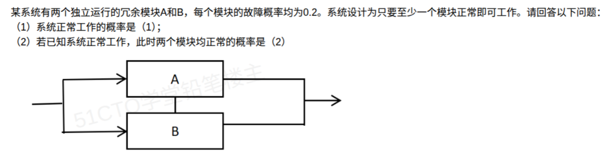

# 备考笔记：并联冗余-条件概率

## 一、题目

> 某系统有两个独立运行的冗余模块 A 和 B，每个模块的故障概率均为 0.2。系统设计为只要至少一个模块正常即可工作。请回答以下问题：
>
> （1）系统正常工作的概率是（1）；
>
> （2）若已知系统正常工作，此时两个模块均正常的概率是（2）。

**答案：（1）0.96；（2）2/3（≈0.667）**

## 二、知识点：并联冗余-条件概率

### 1. 核心原理

本题把**并联冗余可靠性**与**条件概率（贝叶斯）**串在一起考，两问一条链：

- **第（1）问是正向可靠性计算**：并联冗余（至少一个正常即可工作）的通法是**先算全部失效、再取反**——"系统正常"的对立事件是"A、B 同时故障"。
- **第（2）问是逆向条件概率**："已知系统正常"缩小了样本空间，在此前提下求"两模块均正常"的占比。系统正常包含两种情形：**均正常**（概率 0.64）或**恰一个正常**（概率 0.32），所以均正常的占比是 0.64/0.96 = 2/3，**小于 1**——这是本题最容易直觉出错的地方。

设事件：$P(A故障)=P(B故障)=0.2$，$P(A正常)=P(B正常)=0.8$，A、B 相互独立。

### 2. 关键公式/规则

| 名称 | 表达式 | 本题取值 |
| --- | --- | --- |
| 并联系统正常概率 | $P(\text{正常})=1-(1-R_1)(1-R_2)\cdots$ | $1-0.2\times0.2=0.96$ |
| 独立事件同时发生 | $P(AB)=P(A)\,P(B)$ | $0.8\times0.8=0.64$ |
| 条件概率定义 | $P(B\mid A)=\dfrac{P(AB)}{P(A)}$ | $\dfrac{0.64}{0.96}=\dfrac{2}{3}$ |

### 3. 解题步骤

1. **第（1）问——取对立事件**："至少一个正常" ⟷ "两个都故障"：

   $$P(\text{系统正常})=1-0.2\times0.2=1-0.04=0.96$$

2. **第（2）问——套条件概率**：注意"均正常"是"系统正常"的**子集**（均正常必然系统正常）：

   $$P(\text{均正常}\mid\text{系统正常})=\frac{P(\text{均正常})}{P(\text{系统正常})}=\frac{0.8\times0.8}{0.96}=\frac{0.64}{0.96}=\frac{2}{3}\approx0.667$$

3. **验算**（分类法）：系统正常 = 均正常 0.64 + 恰坏一个 $2\times0.8\times0.2=0.32$，合计 0.96 ✓；均正常占比 $0.64/(0.64+0.32)=2/3$ ✓。

## 三、易错点

1. **第（2）问直觉误答"0.64"**：忘除以"已知系统正常"这个前提，把联合概率当条件概率。已知条件缩小了样本空间，必须除以 $P(\text{系统正常})=0.96$。
2. **直觉误答"1"或接近 1**：觉得"系统都正常工作了，肯定俩模块都好啊"。错——系统正常允许**恰好坏一个**（另一个顶上），此情形概率 0.32 不小，所以均正常只占 2/3。
3. **第（1）问误算 0.8**：只算了一个模块正常，忘了并联冗余是"至少一个"，正确做法是**减去全失效**。
4. **"独立"两字没用上**：题目强调独立运行，就是为了让你直接乘概率 $P(AB)=P(A)P(B)$；若不独立则不能连乘。
5. **混淆条件概率方向**：$P(\text{均正常}\mid\text{系统正常})=2/3$，而 $P(\text{系统正常}\mid\text{均正常})=1$，两者完全不同，看清"已知"在后。

## 四、扩展延伸

- **与可靠性笔记的衔接**：第（1）问即 [06-系统可靠性-串并联冗余模型.md](06-系统可靠性-串并联冗余模型.md) 中"并联取反乘"公式 $R_p=1-(1-R)^n$ 的数字版（$1-0.2^2=0.96$）。
- **与贝叶斯笔记的衔接**：第（2）问与 [61-贝叶斯公式-次品来源概率比较.md](61-贝叶斯公式-次品来源概率比较.md) 同属"由果溯因"：结果（系统正常）已知，反推状态（均正常）的概率，本质都是 $P(\text{状态}\mid\text{结果})=\dfrac{P(\text{状态}\cap\text{结果})}{P(\text{结果})}$。
- **规律记忆**：n 个故障率为 f 的独立模块并联，已知系统正常时**全部正常**的后验概率为 $\dfrac{(1-f)^n}{1-f^n}$。f 越小该值越接近 1，f 越大越偏离 1（冗余"顶班"的情形越多）。
- **现实类比**：双机热备系统"服务未中断"不代表两台机器都健康——可能一台早坏了另一台在独撑。监控看到"服务正常"时要意识到"双机都健康"的概率只有 2/3，这正是运维要做**单点故障检测**的原因。

## 五、错题归档

| 题号 | 题型 | 考点 | 难度 | 掌握度 |
| --- | --- | --- | --- | --- |
| 系统分析师-数学与经济管理（概率） | 单选（两空） | 并联冗余可靠性 + 条件概率：已知系统正常求两模块均正常（2/3） | 中 | 待复习 |

（重做本题时在表尾追加 `重做 N` 行，见「步骤 2.5 重做留痕」）

## 六、相关图片

原题截图：`../images/118-并联冗余-条件概率.png`（由用户上传的原题图复制改名而来）

