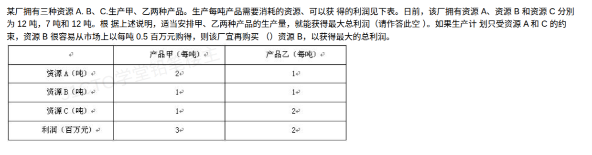

# 备考笔记：线性规划-最大利润与资源采购

## 一、题目

> 某厂拥有三种资源 A、B、C，生产甲、乙两种产品。生产每吨产品需要消耗的资源、可以获得的利润见下表。日前，该厂拥有资源 A、资源 B 和资源 C 分别为 12 吨、7 吨和 12 吨。根据上述说明，适当安排甲、乙两种产品的生产量，就能获得最大总利润（请作答此空）。如果生产计划只受资源 A 和 C 的约束，资源 B 很容易从市场上以每吨 0.5 百万元购得，则该厂宜再购买（ ）资源 B，以获得最大的总利润。
>
> |  | 产品甲（每吨） | 产品乙（每吨） |
> | --- | --- | --- |
> | 资源 A（吨） | 2 | 1 |
> | 资源 B（吨） | 1 | 1 |
> | 资源 C（吨） | 1 | 2 |
> | 利润（百万元） | 3 | 2 |

**答案：最大总利润 19 百万元（甲 5 吨、乙 2 吨）；宜再购买 1 吨资源 B**

## 二、知识点：线性规划-最大利润与资源采购

### 1. 核心原理

- **线性规划求最值**：目标函数与约束均为线性，最优解必在**可行域顶点**处取得。把所有约束两两求交点，逐一检验"是否满足其余约束、是否在坐标轴截距内"，取目标函数最大者即可。
- **影子价格（第二问的本质）**：某资源的影子价格 = 在最优解处该资源每增加 1 单位所带来的目标函数增量。影子价格 > 市场买入价 → 值得买；影子价格 = 0（该资源不再稀缺/已有别的约束顶替）→ 不值得买。**买入量恰买到"影子价格降到买入价"或"该约束松开"为止**。

设生产甲 $x$ 吨、乙 $y$ 吨：

$$\max Z = 3x + 2y,\quad \text{s.t.}\ \begin{cases}2x + y \le 12 & (\text{A})\\ x + y \le 7 & (\text{B})\\ x + 2y \le 12 & (\text{C})\\ x, y \ge 0\end{cases}$$

### 2. 关键公式/规则

| 名称 | 表达式 | 本题取值 |
| --- | --- | --- |
| 顶点枚举 | 两约束求交点，代入其余约束检验 | 见下表 |
| 影子价格 | $\dfrac{\Delta Z}{\Delta\text{资源量}}$（最优解处约束右端增量） | B：每吨 +1 百万元 |
| 采购判据 | 影子价格 > 买入价 → 买，买到边际收益=价格 | $1 > 0.5$，买 1 吨 |

顶点检验表（第一问）：

| 顶点 | 来源 | 其余约束检验 | Z=3x+2y |
| --- | --- | --- | --- |
| (6, 0) | A∩x 轴 | B:6≤7✓，C:6≤12✓ | 18 |
| (0, 6) | C∩y 轴 | A:6≤12✓，B:6≤7✓ | 12 |
| **(5, 2)** | **A∩B** | C:9≤12✓ | **19（最大）** |
| (2, 5) | B∩C | A:9≤12✓ | 16 |
| (4, 4) | A∩C | B:8>7 ✗ 舍 | — |

### 3. 解题步骤

1. **设变量、列目标与约束**：$\max Z=3x+2y$，三条资源约束。
2. **求轴截距顶点与两两交点**：(6,0)、(0,6)、(5,2)、(2,5)、(4,4)。
3. **逐点检验可行性与目标值**：只有 (5,2) 给出最大值 $3\times5+2\times2=19$ → **最大总利润 19 百万元**。
4. **第二问——松开 B 约束重解**：只剩 A、C 约束时，A∩C 交点 $(4,4)$ 变为可行，$Z=3\times4+2\times4=20$，此时需资源 B 共 $4+4=8$ 吨。
5. **算采购量**：$8-7=$ **再买 1 吨资源 B**。净利润 $=20-0.5\times1=19.5>19$，划算。
6. **验证为何不买更多**：设购买 $b$ 吨（$0\le b\le1$），最优顶点沿 A∩B 移动，$Z=19+b$，净利 $19+0.5b$ 在 $b=1$ 处达 19.5；$b>1$ 后 A、C 全部绑定，$Z$ 恒为 20 而成本 $0.5b$ 继续涨，净利下降。故**恰买 1 吨**。

## 三、易错点

1. **顶点漏算或忘检验**：(4,4) 是 A∩C 交点，单看目标值 $Z=20$ 最大，但它**违反 B 约束**（需 B 8 吨 > 7 吨），必须舍去——这正是第二问的伏笔：第一问最优点"卡"在 B 上。
2. **误答再买 8 吨**：8 是松开 B 后所需的**总量**，不是购买量；厂里已有 7 吨，只需补 $8-7=1$ 吨。
3. **忽略采购成本**：利润必须**扣除**买 B 花的 0.5 百万元，净利 19.5 而非 20。
4. **以为买得越多赚得越多**：B 超过 1 吨后瓶颈换成 A 和 C，B 的影子价格降为 0，再买纯亏 0.5/吨。
5. **影子价格与单价比较方向搞反**：影子价格（1）> 买入价（0.5）才买；若题目反过来（影子价格 < 买入价）则不买、维持原计划。

## 四、扩展延伸

- **影子价格的通用读法**：最优解处**绑定的约束**（取等号的）影子价格 ≥ 0，**松驰的约束**影子价格 = 0。本题最优 (5,2) 处 A、B 绑定，C 松驰（9<12）→ C 的影子价格为 0，A、B 各有正影子价格。
- **对偶验证**：A 的影子价格 = 1（$b=1$ 时 $Z$ 从 19→20 全程由 A∩B 顶点滑动给出，其中 A、B 各贡献一部分），B 的影子价格 = 1，均大于其市场价时都应考虑补购。
- **图解法要点**：可行域是凸多边形，目标函数等值线 $3x+2y=k$ 沿法向量 $(3,2)$ 平移，离原点最远仍与可行域相交处即最优——等值线斜率 $-3/2$ 介于两条绑定约束斜率之间时，最优解唯一。
- **同类真题变式**：常改为"资源 C 可购入/资源 A 可租借"，套路不变：松开该约束重解 → 求增量 → 与单价比较 → 算净利。
- **现实类比**：工厂"卡脖子"的原料才值得加价抢购；不缺的原料（影子价格 0）白送也要想想要不要占库存。

## 五、错题归档

| 题号 | 题型 | 考点 | 难度 | 掌握度 |
| --- | --- | --- | --- | --- |
| 系统分析师-数学与经济管理（线性规划） | 单选（两空） | 顶点枚举求最大利润（19）+ 影子价格判断资源采购量（再买 1 吨 B） | 中 | 待复习 |

（重做本题时在表尾追加 `重做 N` 行，见「步骤 2.5 重做留痕」）

## 六、相关图片

原题截图：`../images/119-线性规划-最大利润与资源采购.png`（由用户上传的原题图复制改名而来）

