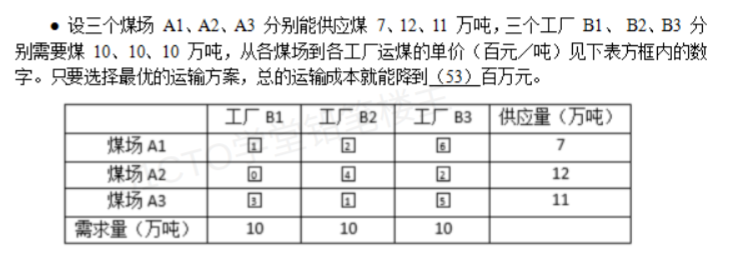

# 备考笔记：运输问题-最小运费方案

## 一、题目

> 设三个煤场 A1、A2、A3 分别能供应 7、12、11 万吨，三个工厂 B1、B2、B3 分别需要 10、10、10 万吨，从各煤场到各工厂运煤的单价（百元/吨）见下表方框内的数字。只要选择最优的运输方案，总的运输成本就能降到（53）百万元。
>
> |  | 工厂 B1 | 工厂 B2 | 工厂 B3 | 供应量（万吨） |
> | --- | --- | --- | --- | --- |
> | 煤场 A1 | ① | ② | ⑥ | 7 |
> | 煤场 A2 | ⑩ | ④ | ② | 12 |
> | 煤场 A3 | ③ | ① | ⑤ | 11 |
> | 需求量（万吨） | 10 | 10 | 10 |  |

**答案：52 百万元**

## 二、知识点：运输问题-最小运费方案

### 1. 核心原理

- **产销平衡运输问题**：总供应量 = 总需求量（本题 7+12+11 = 10+10+10 = 30），属标准运输模型。设 $x_{ij}$ 为煤场 $i$ 运往工厂 $j$ 的万吨数，目标是最小化总运费，约束为每行供应量用完、每列需求量满足。
- **最优方案构造直觉**：先掐死"天价格"格（A2→B1 单价 10），让每个工厂尽量由**最便宜的供应商**按剩余量凑满；再用**位势法（MODI）**检验所有空格检验数 $\sigma_{ij}=c_{ij}-u_i-v_j\ge 0$ 确认最优。
- **单位换算关键**：单价（百元/吨）× 运量（万吨）= 百元 × 万 = $10^2 \times 10^4 = 10^6$ 元 = **百万元**。所以表内数字直接"单价 × 运量"相乘再求和，结果单位就是百万元，**不用再乘系数**。

### 2. 关键公式/规则

| 名称 | 表达式 | 本题取值 |
| --- | --- | --- |
| 总运费 | $Z=\sum_i\sum_j c_{ij}x_{ij}$（结果即百万元） | 52 |
| 位势方程 | 基变量格：$c_{ij}=u_i+v_j$ | $u_1=0$ 起算 |
| 检验数 | 空格：$\sigma_{ij}=c_{ij}-u_i-v_j$，全部 $\ge 0$ 即最优 | 见下表 |

最优调运方案与费用：

| 调运 | 运量（万吨） | 单价 | 费用（百万元） |
| --- | --- | --- | --- |
| A1→B1 | 7 | 1 | 7 |
| A3→B1 | 3 | 3 | 9 |
| A3→B2 | 8 | 1 | 8 |
| A2→B2 | 2 | 4 | 8 |
| A2→B3 | 10 | 2 | 20 |
| **合计** | 30 | — | **52** |

最优性检验（位势法）：基变量 $x_{11},x_{31},x_{32},x_{22},x_{23}$，令 $u_1=0$，依次解出 $v_1=1,\ u_3=2,\ v_2=-1,\ u_2=5,\ v_3=-3$。空格检验数：

| 空格 | $\sigma_{ij}=c_{ij}-u_i-v_j$ | 判定 |
| --- | --- | --- |
| x12 | $2-0-(-1)=3$ | ≥0 ✓ |
| x13 | $6-0-(-3)=9$ | ≥0 ✓ |
| x21 | $10-5-1=4$ | ≥0 ✓ |
| x33 | $5-2-(-3)=6$ | ≥0 ✓ |

全部非负 → **52 百万元为唯一最优值**。

### 3. 解题步骤

1. **核对产销平衡**：供 30 = 需 30，标准运输问题。
2. **识别天价格并排布**：A2→B1（10）绝不用。B1 的 10 万吨 = A1 的 7 万吨（单价1）+ A3 的 3 万吨（单价3）；A3 还剩 8 万吨全给 B2（单价1）；B2 缺的 2 万吨由 A2 补（单价4）；A2 剩 10 万吨全给 B3（单价2）。
3. **求和**：$7\times1+3\times3+8\times1+2\times4+10\times2=52$ 百万元。
4. **位势法验证**（考场可跳过，直觉方案恰为最优）：全部检验数 ≥ 0，确认最优。
5. **对照选项**：若无 52，检查是否误用了最小元素法初始解 60（未调整）。

## 三、易错点

1. **单位换算出错**：单价是"百元/吨"、运量是"万吨"，乘出来**恰好是百万元**（$10^2\times10^4=10^6$ 元）。若误乘成"万元"（×10）或"千万元"（÷10）就会选到 520 或 5.2。
2. **用最小元素法初始解当答案**：按"全表最便宜优先"顺序填（先 x11=7、再 x32=10、再 x31=1、x21=2、x23=10）得 **60**，不是最优——位势法检验发现 x22 检验数 $-4<0$，闭回路调整 2 万吨后才降到 52。**初始解 ≠ 最优解**。
3. **漏掉检验、凭直觉选次优**：直觉方案（本题恰好最优）不保证总是最优，正规做法是最小元素法/Vogel 法求初始 + 位势法判优 + 闭回路调整。
4. **产销不平衡误加虚拟行列**：本题供给恰等于需求，无需虚设；若不相等才要补虚拟行（列），其运价填 0。
5. **行列约束算错方向**：每行合计必须**等于**供应量（7、12、11），每列合计必须**等于**需求量（各 10），本题最优方案逐行 7/12/11、逐列 10/10/10，可快速代回自查。

## 四、扩展延伸

- **最小元素法 vs Vogel 法**：最小元素法按"最便宜格优先"填；Vogel 法按"行/列次小差（机会成本罚数）"最大的行列优先填。本题 Vogel 法一步即得最优 52，最小元素法得 60 需调整一次——Vogel 法初始解通常更接近最优。
- **闭回路调整**：检验数出现负值时，从该空格出发找"横平竖直、拐角均为基变量"的闭回路，空格标 +、依次交替 ±，取偶拐角最小值为调整量。本题 $x_{22}$ 进基，回路 $x_{22}^{+}\to x_{21}^{-}\to x_{31}^{+}\to x_{32}^{-}$，调整 2，$Z$ 降 $4\times2=8$，即 $60-8=52$。
- **对偶视角**：位势 $u_i$（煤场）与 $v_j$（工厂）即运输问题对偶变量；$v_j$ 可为负说明"在哪个厂卸货"本身有价值差异，不必纠结位势为负。
- **产销不平衡变式**：供大于需时加"虚拟工厂"消化多余供应；需大于供时加"虚拟煤场"，对应运价 0，先满足哪方由罚数法决定。
- **同类真题**：软考数学题中运输问题、线性规划（顶点法）、盈亏平衡是三大常客，前两者都考"最优方案 + 最值"，区别是运输问题有**结构化表格**可套口诀，线性规划靠**画图找顶点**。

## 五、错题归档

| 题号 | 题型 | 考点 | 难度 | 掌握度 |
| --- | --- | --- | --- | --- |
| 系统分析师-数学与经济管理（运输问题，第 53 题） | 单选 | 产销平衡运输问题：直觉排优 + 位势法检验，最小运费 52 百万元 | 中 | 待复习 |

（重做本题时在表尾追加 `重做 N` 行，见「步骤 2.5 重做留痕」）

## 六、相关图片

原题截图：`../images/123-运输问题-最小运费方案.png`（由用户上传的原题图复制改名而来）

