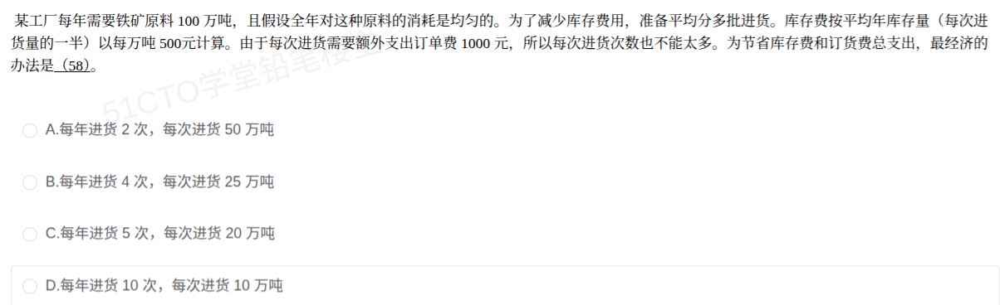

# 备考笔记：经济订货批量-库存费与订货费权衡

## 一、题目

> 某工厂每年需要铁矿石原料 100 万吨，且假设全年对这种原料的消耗是均匀的。为了减少库存费用，准备平均分多批进货。库存费按平均年库存量（每次进货量的一半）以每万吨 500 元计算。由于每次进货需要额外支出订单费 1000 元，所以每次进货次数也不能太多。为节省库存费和订货费总支出，最经济的办法是（58）。
>
> A. 每年进货 2 次，每次进货 50 万吨
> B. 每年进货 4 次，每次进货 25 万吨
> C. 每年进货 5 次，每次进货 20 万吨
> D. 每年进货 10 次，每次进货 10 万吨

**答案：C. 每年进货 5 次，每次进货 20 万吨**

## 二、知识点：经济订货批量-库存费与订货费权衡

### 1. 核心原理

- **两类成本的天然矛盾**：每次进货量 $Q$ 越大 → 年库存费越高（平均库存 $\frac{Q}{2}$ 大）；进货次数 $n$ 越多 → 年订货费越高（$n \times$ 单次订货费）。两者此消彼长，**总费用曲线呈 U 形**，存在最低点。
- **经济订货批量 EOQ（Economic Order Quantity）**：使"库存费 = 订货费"的进货量就是最优批量——因为二者此消彼长，**在最优处恰好相等**。本题选项 C 处库存费与订货费同为 5000 元，正体现这一经典性质。

### 2. 关键公式/规则

| 名称 | 表达式 | 本题取值 |
| --- | --- | --- |
| 年总费用 | $TC = \dfrac{Q}{2} \times h + \dfrac{D}{Q} \times S$ | $h=500$ 元/万吨·年，$S=1000$ 元/次 |
| 需求量 $D$ | 年总需求 | $D = 100$ 万吨 |
| EOQ 最优批量 | $Q^* = \sqrt{\dfrac{2DS}{h}}$ | $\sqrt{\frac{2 \times 100 \times 1000}{500}} = \sqrt{400} = 20$ 万吨 |
| 最优次数 | $n^* = \dfrac{D}{Q^*}$ | $100 / 20 = 5$ 次 |
| 最优时性质 | 库存费 = 订货费 = $\sqrt{\dfrac{DSH}{2}}$ | 各 5000 元，总 10000 元 |

### 3. 解题步骤

1. **识别模型**：均匀消耗 + 每批进货 + 库存费按平均库存（$\frac{Q}{2}$）计 + 每次订货固定费 → EOQ 权衡模型。
2. **逐项代入计算**（单位：万吨、元）：

   | 选项 | $n$（次） | $Q$（万吨） | 库存费 $\frac{Q}{2}\times500$ | 订货费 $n\times1000$ | 总费用 |
   | --- | --- | --- | --- | --- | --- |
   | A | 2 | 50 | $25\times500=12500$ | $2000$ | 14500 |
   | B | 4 | 25 | $12.5\times500=6250$ | $4000$ | 10250 |
   | **C** | **5** | **20** | $10\times500=5000$ | $5000$ | **10000（最小）** |
   | D | 10 | 10 | $5\times500=2500$ | $10000$ | 12500 |

3. **选总费用最小者**：**C，10000 元**。
4. **公式法验证**：$Q^* = \sqrt{2DS/H} = \sqrt{400} = 20$ 万吨 → 每年 $100/20 = 5$ 次，与枚举一致。

## 三、易错点

1. **平均库存漏掉"一半"**：库存费必须按 $\frac{Q}{2}$ 计（均匀消耗下从满库线性降到 0），用 $Q$ 直接乘单价会算出翻倍的费用、错选 D。
2. **只看库存费或只看订货费单边**：库存费随次数增加而降（A→D 递减）、订货费随次数增加而升，必须**相加取总**，只比单项必然出错。
3. **单位换算混乱**：库存费单价是"每万吨 500 元"，订货费是"每次 1000 元"，$Q$ 以万吨代入即可，不必换算成吨，否则数量级出错。
4. **凭直觉选进货次数最少/最多**：直觉上"少进货省事"（选 A）或"多分批降库存"（选 D）都不对，最优在**中间**——两力平衡处。
5. **忘记 EOQ 的等费性质做检验**：最优解处库存费 = 订货费，可用此快速锁定正确选项（C 项两项恰各 5000 元）。

## 四、扩展延伸

- **EOQ 公式推导**：对 $TC(Q)=\frac{hQ}{2}+\frac{DS}{Q}$ 求导令零：$\frac{h}{2}=\frac{DS}{Q^2}$ → $Q^*=\sqrt{\frac{2DS}{h}}$。此时库存费 $\frac{hQ^*}{2}$ 与订货费 $\frac{DS}{Q^*}$ **恰好相等**，总费用 $=\sqrt{2DSh}$（本题 $\sqrt{2\times100\times1000\times500}=10000$ 元）。
- **与线性规划的对比**：线性规划处理**多约束下的资源分配**（如笔记 119），EOQ 处理**无约束的单变量权衡**，两者都是"数学与经济管理"高频考点，但 EOQ 一元求导/枚举即可，难度更低。
- **变式套路**：真题常换皮——订货费改"运输费"、库存费改"仓储保管费"、或给出"自制 vs 外购"对比，模型不变：**总费用 = 批次固定费 × (D/Q) + 持有费 × (Q/2)**。
- **敏感性与现实类比**：总费用曲线在 $Q^*$ 附近很平坦（$\pm$20% 批量只多花约 2% 费用），所以现实企业宁可略偏离最优也要凑整车、凑整箱——"经济批量不必死抠整数解"。像租房：租大房子（库存费高）但搬家次数少（订货费低），住多大面积最划算要看两笔钱之和。

## 五、错题归档

| 题号 | 题型 | 考点 | 难度 | 掌握度 |
| --- | --- | --- | --- | --- |
| 信息系统项目管理师/系统分析师-数学与经济管理 | 单选 | EOQ 经济订货批量：库存费与订货费权衡（最优 5 次×20 万吨） | 中 | 待复习 |

（重做本题时在表尾追加 `重做 N` 行，见「步骤 2.5 重做留痕」）

## 六、相关图片

原题截图：`../images/124-经济订货批量-库存费与订货费权衡.png`（由用户上传的原题图复制改名而来）

