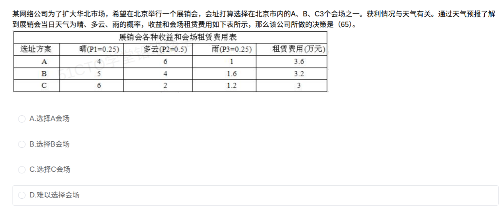

# 备考笔记：期望值决策-会场选址

## 一、题目

> 某网络公司为了扩大华北市场，希望在北京举行一个展销会，会址打算选择在北京市内的A、B、C 3个会场之一。获利情况与天气有关。通过天气预报了解到展销会当日天气为晴、多云、雨的概率，收益和会场租赁费用如下表所示，那么该公司所做的决策是（65）。
>
> | 选址方案 | 晴(P1=0.25) | 多云(P2=0.5) | 雨(P3=0.25) | 租赁费用(万元) |
> | --- | --- | --- | --- | --- |
> | A | 4 | 6 | 1 | 3.6 |
> | B | 5 | 4 | 1.6 | 3.2 |
> | C | 6 | 2 | 1.2 | 3 |
>
> A. 选择A会场
> B. 选择B会场
> C. 选择C会场
> D. 难以选择会场

**答案：A. 选择A会场**

## 二、知识点：期望值决策-会场选址

### 1. 核心原理

这是**风险型决策**（自然状态概率已知）的标准解法——**期望货币值法（EMV，Expected Monetary Value）**：每个备选方案的收益随天气（自然状态）变化，而各状态概率已知，就按概率对收益**加权平均**得到该方案的期望收益，再**扣除固定支出（租赁费用）**得到期望净收益，**取期望净收益最大**的方案。

一句话：**期望毛收益 − 固定成本 = 期望净收益，选最大者**。

### 2. 关键公式/规则

| 名称 | 表达式 | 说明 |
| --- | --- | --- |
| 期望毛收益 | $E(R)=\sum_i P_i \times R_i$ | 各状态收益按概率加权求和 |
| 期望净收益 | $E(\text{净})=E(R)-C$ | $C$ 为租赁费等固定支出 |
| 决策规则 | 选 $\max\{E(\text{净})\}$ 对应方案 | 净期望为负的方案直接淘汰 |

### 3. 解题步骤

1. **列式算三个方案的期望毛收益**（概率 0.25 / 0.5 / 0.25）：
   - A：$4\times0.25+6\times0.5+1\times0.25=1+3+0.25=4.25$
   - B：$5\times0.25+4\times0.5+1.6\times0.25=1.25+2+0.4=3.65$
   - C：$6\times0.25+2\times0.5+1.2\times0.25=1.5+1+0.3=2.8$
2. **各减租赁费用得期望净收益**：
   - A：$4.25-3.6=\mathbf{0.65}$ 万元
   - B：$3.65-3.2=\mathbf{0.45}$ 万元
   - C：$2.8-3=\mathbf{-0.2}$ 万元（亏，直接淘汰）
3. **比较取最大**：$0.65>0.45>-0.2$，选 **A 会场**。

（验算：即使不扣租赁费，毛收益也是 A 最高 4.25>3.65>2.8，两种口径答案一致，选 A 稳。）

## 三、易错点

1. **忘记扣租赁费用**：只算加权收益就比大小（本题恰好答案不变，但数字全错，遇到租赁费影响排序的变体就翻车）。表格单独给出"租赁费用"列，就是在提醒你要减。
2. **概率代错**：题面表头写的是 P1=0.25（晴）、P2=0.5（多云）、P3=0.25（雨），别按"晴0.5"惯性代入；多云概率 0.5 权重最大，谁在多云列收益高谁占优——这正是 A（6）胜出的关键。
3. **误选 C**：只盯着晴天收益最高（C 晴天 6 万元）做"乐观决策"，忽略了晴天只有 25% 概率，且 C 租金后净亏 0.2 万元。
4. **误选 D"难以选择"**：概率已知就不是不确定型决策，必有唯一期望值最大的方案，不存在"无法决策"。
5. **期望≠实际**：期望净收益 0.65 万元是"多次重复的平均意义"上的值，单次实际结果可能是雨天只赚 1−3.6=−2.6 万元，不要用"万一下雨就亏"否定期望值法。

## 四、扩展延伸

- **与贝叶斯/条件概率的衔接**：[61-贝叶斯公式-次品来源概率比较.md](61-贝叶斯公式-次品来源概率比较.md)、[118-并联冗余-条件概率.md](118-并联冗余-条件概率.md) 处理"概率反推"，本题处理"概率加权正向算期望"，同属数学与经济管理高频计算题。
- **与不确定性决策四准则对比**（概率未知时才用）：乐观法（大中取大）、悲观法（小中取大）、后悔值法（大中取小 regret）、等可能法（拉普拉斯，视各状态等概率）。本题概率已知，属于风险型，用 EMV。
- **决策树视角**：方框=决策点，圆=状态点（各分支标概率，末端标收益），把每个方案的 EMV 标在状态点旁，剪掉非最优枝即可，本质与本表算法相同。
- **出题变式**：①改问"期望净收益最大的是哪个会场"（同解）；②给期望收益让反推概率或某格收益；③加"若聘请气象服务获得准确预报，最多愿付多少费用"——答案是**完全信息的期望价值 EVPI = 先验最优 EMV 与全信息后验最优期望之差**。
- **现实类比**：选址、囤货、广告投放等"结果受环境状态影响"的一次性投入决策，都可用"概率加权收益 − 固定成本"的 EMV 框架拍板。

## 五、错题归档

| 题号 | 题型 | 考点 | 难度 | 掌握度 |
| --- | --- | --- | --- | --- |
| 系统分析师-数学与经济管理（决策论） | 单选 | 风险型决策 EMV：期望毛收益减租赁费用取最大（A 0.65 > B 0.45 > C −0.2） | 中 | 待复习 |

（重做本题时在表尾追加 `重做 N` 行，见「步骤 2.5 重做留痕」）

## 六、相关图片

原题截图：`../images/130-期望值决策-会场选址.png`（由用户上传的原题图复制改名而来）

