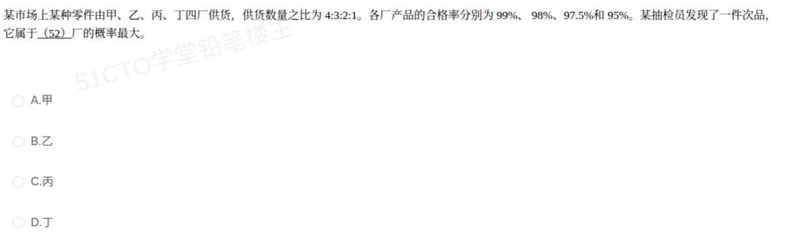

# 备考笔记：贝叶斯公式-合格率换算与次品来源判定

## 一、题目

> 某市场上某种零件由甲、乙、丙、丁四厂供货，供货数量之比为 4:3:2:1。各厂产品的合格率分别为 99%、98%、97.5%和95%。某抽检员发现了一件次品，它属于（ ）厂的概率最大。
>
> A. 甲
> B. 乙
> C. 丙
> D. 丁

**答案：B. 乙**

解析：这是典型的**贝叶斯（逆概）问题**，且比常规题多了一步陷阱——题目给的是**合格率**，必须先换算成**次品率**（次品率 = 1 − 合格率）再参与计算：

- 甲：$P(\text{甲})P(\text{次品}\mid\text{甲})=0.4\times0.01=0.004$
- 乙：$P(\text{乙})P(\text{次品}\mid\text{乙})=0.3\times0.02=0.006$
- 丙：$P(\text{丙})P(\text{次品}\mid\text{丙})=0.2\times0.025=0.005$
- 丁：$P(\text{丁})P(\text{次品}\mid\text{丁})=0.1\times0.05=0.005$

四者的联合概率和为 $0.004+0.006+0.005+0.005=0.020$（即全概率公式给出的**总次品率 2%**）。后验概率：

- $P(\text{甲}\mid\text{次品})=0.004/0.020=20\%$
- $P(\text{乙}\mid\text{次品})=0.006/0.020=30\%$
- $P(\text{丙}\mid\text{次品})=0.005/0.020=25\%$
- $P(\text{丁}\mid\text{次品})=0.005/0.020=25\%$

乙厂后验概率最大，故这件次品**最可能来自乙厂**，选 **B**。

> 关键点：**比较后验只需比较"先验 × 似然"这一乘积**（分母 $P(\text{次品})$ 对四家相同，可约去），不必真算出百分数。本题的额外陷阱是**先验给供货比、似然给合格率**，两处都要先换算成标准形式（份额概率、次品率）再相乘。

## 二、知识点：贝叶斯公式-合格率换算与次品来源判定

### 1. 核心原理

**（1）先验概率（Prior）**：抽检前，零件来自某厂的概率由**供货数量之比**决定。比例 4:3:2:1 归一化为 $P(\text{甲})=0.4$、$P(\text{乙})=0.3$、$P(\text{丙})=0.2$、$P(\text{丁})=0.1$。

**（2）似然 / 条件概率（Likelihood）**：各家自己的**次品率**。注意题目给的是**合格率**，须换算：

$$P(\text{次品}\mid\text{来源}_i)=1-\text{合格率}_i$$

得甲 0.01、乙 0.02、丙 0.025、丁 0.05。

**（3）全概率公式**：把"是次品"按来源拆开相加，得到**总的次品率**

$$P(\text{次品})=\sum_i P(\text{来源}_i)\,P(\text{次品}\mid\text{来源}_i)=0.020$$

**（4）贝叶斯公式（后验）**：反过来问"已知是次品，来自某厂的概率"

$$P(\text{来源}_i\mid\text{次品})=\frac{P(\text{来源}_i)\,P(\text{次品}\mid\text{来源}_i)}{P(\text{次品})}$$

即 **后验 ∝ 先验 × 似然**。分母 $P(\text{次品})$ 是四家的公共项，**比较谁最大时可直接省略**。

### 2. 关键公式/规则

| 名称 | 表达式 | 本题取值 |
| --- | --- | --- |
| 先验概率（供货比归一化） | $P(\text{来源}_i)=\dfrac{\text{该厂供货份额}}{\text{总份额}}$ | 甲 0.4，乙 0.3，丙 0.2，丁 0.1 |
| 次品率换算 | $P(\text{次品}\mid\text{源})=1-\text{合格率}$ | 甲 0.01，乙 0.02，丙 0.025，丁 0.05 |
| 全概率公式 | $P(\text{次品})=\sum_i P(\text{源}_i)P(\text{次}\mid\text{源}_i)$ | 0.004+0.006+0.005+0.005=**0.020** |
| 贝叶斯公式 | $P(\text{源}_i\mid\text{次})=\dfrac{P(\text{源}_i)P(\text{次}\mid\text{源}_i)}{P(\text{次品})}$ | 见下表 |
| **比较口诀** | 后验 ∝ 先验 × 似然，分母相同可约去 | 直接比 0.006 > 0.005 = 0.005 > 0.004 |

| 来源 | 先验 $P$ | 次品率 $P(\text{次}\mid\text{源})$ | 联合 $P\times P(\text{次}\mid\text{源})$ | 后验 $P(\text{源}\mid\text{次})$ |
| --- | --- | --- | --- | --- |
| 甲 | 0.40 | 0.01 | 0.004 | 20% |
| 乙 | 0.30 | 0.02 | **0.006** | **30%（最大）** |
| 丙 | 0.20 | 0.025 | 0.005 | 25% |
| 丁 | 0.10 | 0.05 | 0.005 | 25% |
| 合计 | 1.00 | — | 0.020 | 100% |

### 3. 解题步骤

1. **换算先验**：把供货比 4:3:2:1 归一化为 0.4/0.3/0.2/0.1。
2. **换算似然**：合格率逐个取补 → 次品率 1%/2%/2.5%/5%。
3. **算联合（先验 × 次品率）**：0.004、0.006、0.005、0.005。
4. **求和得全概率**：0.020（即总次品率）。
5. **比大小定答案**：联合概率最大者即为最可能来源 → **乙厂（B）**；若要求具体后验，再各自除以 0.020。

## 三、易错点

1. **把合格率当次品率直接相乘**：$0.4\times0.99$ 算出的是"来自甲且合格"的联合概率，方向完全反了。看到"合格率"三个字必须先取补：次品率 = 1 − 合格率。
2. **误选丁厂**：丁次品率最高（5%）就选丁，是**只看似然、忽略先验**的典型错误。丁的供货只占 10%，先验太小，被乙的"较高供货量 + 较高次品率"反超。
3. **误选甲厂**：甲供货量最大（40%）就选甲，是**只看先验、忽略似然**的反向错误。甲合格率最高（次品率仅 1%），联合概率反而最小。
4. **供货比不归一化直接相乘**：用 4×0.01=0.04 与 1×0.05=0.05 比较虽然**大小结论碰巧一致**（比例因子 10 恒定），但若题目问**具体概率值**，不除以总份额 10 就得不到概率。
5. **忘记全概率（不除以分母）**：只比较"先验 × 似然"大小即可选出答案，但若要给出具体后验概率，必须除以 $P(\text{次品})=0.020$。
6. **丙、丁并列的干扰**：本题丙、丁联合概率恰好相等（均 0.005、后验均 25%），若草率比较会误以为"并列即无解"——并列第二不影响选出最大的乙。
7. **混淆"次品率"与"次品来自某厂的概率"**：前者是 $P(\text{次品}\mid\text{来源})$（正向），后者是 $P(\text{来源}\mid\text{次品})$（逆向），**正是贝叶斯要转换的两个方向**。

## 四、扩展延伸

- **与 [61-贝叶斯公式-次品来源概率比较.md](61-贝叶斯公式-次品来源概率比较.md) 的异同**：

| 维度 | 61 题（灯泡三厂） | 本题（零件四厂） |
| --- | --- | --- |
| 来源数 | 3 家 | 4 家 |
| 先验给出方式 | 直接给百分比（70%/20%/10%） | 给**比例** 4:3:2:1，需归一化 |
| 似然给出方式 | 直接给次品率 | 给**合格率**，需取补 |
| 干扰设计 | 次品率最高的丙厂（易误选） | 次品率最高的丁厂 + 供货最多的甲厂（双干扰） |
| 答案 | 甲（先验主导） | 乙（先验与似然平衡后居中者胜） |

- **贝叶斯比较的本质**：后验排名由**先验与似然的乘积**决定，既不单看先验也不单看似然——"高产量低次品率"和"低产量高次品率"都可能不是答案，**乘积最大者胜**。
- **现实类比**：供应链来料不良追责时，综合**供货份额**与**各家不良率**（且注意对方给的可能是一次交检合格率）定位最可疑供应商；医院筛查中"患病率（先验）× 检出率（似然）"决定阳性预测值，逻辑完全一致。
- **正逆两个方向的对照**：

| 方向 | 名称 | 公式 | 本题含义 |
| --- | --- | --- | --- |
| 由因求果 | 全概率公式 | $P(\text{次品})=\sum P(\text{源})P(\text{次}\mid\text{源})$ | 从各家供货份额与次品率算出**总次品率** 0.020 |
| 由果溯因 | 贝叶斯公式 | $P(\text{源}\mid\text{次})=\dfrac{P(\text{源})P(\text{次}\mid\text{源})}{P(\text{次品})}$ | 已知是次品，反推**最可能的来源**（乙） |

## 五、错题归档

| 题号 | 题型 | 考点 | 难度 | 掌握度 |
| --- | --- | --- | --- | --- |
| 系统分析师-数学与经济管理（概率）第52题 | 单选 | 贝叶斯公式：供货比归一化 + 合格率取补为次品率，比较后验判断次品最可能来源（乙厂） | 中 | 待复习 |

（重做本题时在表尾追加 `重做 N` 行，见「步骤 2.5 重做留痕」）

## 六、相关图片

原题截图：`../images/131-贝叶斯公式-合格率换算与次品来源判定.png`（由用户上传的原题图复制改名而来）

