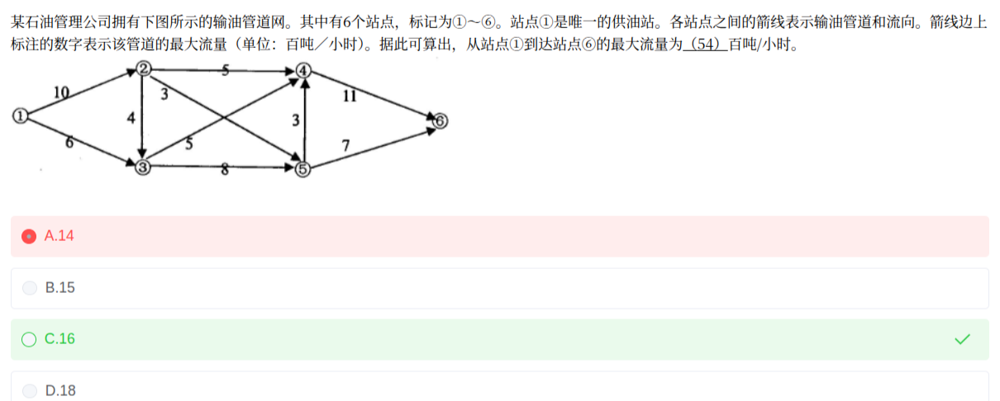

# 备考笔记：输油管道网络-最大流量

## 一、题目

> 某石油管理公司拥有下图所示的输油管道网络。其中有 6 个站点，标记为①~⑥。站点①是唯一的供油站。各站点之间的箭线表示输油管道和流向。箭线上标注的数字表示该管道的最大流量（单位：百吨/小时）。据此可以算出，从站点①到达站点⑥的最大流量为（ ）百吨/小时。
>
> A. 14
> B. 15
> C. 16
> D. 18

**答案：C. 16**

解析：这是**最大流（网络流）**问题，用**增广路径法**逐条找"从①到⑥、每段都有剩余容量"的路径，每条路径能增加的流量 = 路径上**最小容量边**（瓶颈）：

| 增广路径 | 瓶颈 = min(各边剩余容量) | 增流 |
| --- | --- | --- |
| ①→②→④→⑥ | min(10, 5, 11) | 5 |
| ①→③→④→⑥ | min(6, 5, 11−5) | 5 |
| ①→③→⑤→⑥ | min(6−5, 8, 7) | 1 |
| ①→②→③→⑤→⑥ | min(10−5, 4, 8−1, 7−1) | 4 |
| ①→②→⑤→⑥ | min(10−5−4, 3, 7−1−4) | 1 |

累计 5+5+1+4+1 = **16**。此时源点①的出边 ①→②（10）与 ①→③（6）**全部饱和**，再也找不到增广路径，算法终止。割 {①} 的容量 = 10+6 = 16，由**最大流=最小割**定理，最大流量就是 **16 百吨/小时**，选 **C**。

> 关键点：**源点出边之和 16 < 汇点入边之和 18**，整个网络的瓶颈在源头——①能供出的油最多 16，终点⑥最多只可能收 16。本题源点出边恰好能被全部"消化"（②的出边 5+4+3=12≥10，③的入边 6+4=10 ≤ 出边 5+8=13），所以最大流 = 源点出边之和 = 16。

## 二、知识点：最大流-增广路径与最小割

### 1. 核心原理

**（1）流网络**：有向图 G=(V,E)，每条边有容量 c(e)。源点 s（本题站点①）只出不进，汇点 t（本题站点⑥）只进不出。流量满足两条约束：

- **容量约束**：每条边的流量 ≤ 该边容量；
- **守恒约束**：除 s、t 外，每个中间点"流入 = 流出"（油不会凭空产生或消失）。

**（2）最大流**：从 s 到 t 能输送的最大总流量。

**（3）增广路径法（Ford-Fulkerson 思想）**：只要还能找到一条从 s 到 t 的路径，路径上**每条边都有剩余容量**（剩余容量 = 容量 − 已占流量），就让这条路径多送一份流，增加量 = 路径上**最小的剩余容量**（瓶颈边决定）。反复增广，直到找不到增广路径，当前总流量即为最大流。

**（4）割与最大流最小割定理**：把点集分成"含 s 的 S"和"含 t 的 T"两部分，从 S 指向 T 的所有边的**容量之和**称为一个**割的容量**。定理：**最大流 = 最小割**。找到割容量 = 当前流量时，即证明已达最大流（本题割 {①} 容量 16 = 累计流量 16）。

### 2. 关键公式/规则

| 名称 | 表达式 | 本题取值 |
| --- | --- | --- |
| 增广路径增流量 | min(路径上各边剩余容量) | 逐条为 5、5、1、4、1 |
| 剩余容量 | 容量 − 已占流量 | 如 ④→⑥ 用掉 10 后剩 1 |
| 割的容量 | Σc(从 S 侧指向 T 侧的边) | 割 {①}：10+6=**16** |
| 最大流最小割定理 | 最大流 = 最小割 | 16 = 16 |
| 快速上下界估算 | max flow ≤ min(源点出边和， 汇点入边和) | min(10+6, 11+7) = min(16, 18) = 16 |

### 3. 解题步骤

1. **读图建边表**：列出所有有向边及容量（注意箭头方向，交叉对角线最容易看漏）。
2. **先估上下界**：源点出边和 10+6=16，汇点入边和 11+7=18，最大流 ≤ min(16, 18)=16——答案不可能超过 16，直接锁定 C，再用增广路径验证可行性。
3. **逐条找增广路径**：从 ① 出发沿还有剩余容量的边走到 ⑥，每条路径增流 = 路径最小剩余容量；增流后**扣减各边剩余容量**。
4. **重复直到无路可增**：本题 5 条路径后，①→② 与 ①→③ 全部饱和。
5. **用割收尾**：指出一个容量等于当前流量的割（割 {①} = 16），由最大流=最小割确认答案。

## 三、易错点

1. **漏看交叉的两条对角线**：②→⑤（3）和 ③→④（5）在图中交叉，最容易看漏 ②→⑤。漏掉它就凑不出 16，只能算出 5+5+1+4 = **15**，误选 B。读交叉图先数一遍所有边再动笔。
2. **把汇点入边之和 18 当答案**：11+7=18 只是割 {①②③④⑤} 的容量，且源点只能供出 16，永远送不到 18。看到 D 就是掉进了"只看终点入边"的坑。
3. **把"较小者即答案"当成万能公式**：min(16, 18)=16 本题碰巧对，但这是必要条件不是充分条件——若中间边运力不足（如 ② 的出边总和 < 10），实际最大流会更小。**必须用增广路径验证可行流真能达到 16**。
4. **增流后忘记扣减剩余容量**：④→⑥ 已被第一条路径占用 5，第二条路径算瓶颈时必须用 11−5=6，用原容量 11 就会算出超额流量。
5. **路径找不到就提前放弃**：正面直连路径堵死后，要会"绕行"——如 ①→②→③→⑤→⑥ 借道 ②→③。软考此题不需要反向退流，顺着剩余容量找绕行路径即可。
6. **混淆"割"与"任意切断"**：割只统计**从 S 侧指向 T 侧**的边；反向边不计入割容量。最小割是最小值，不是随便一条断开边的和。

## 四、扩展延伸

- **最小割的现实含义**：管道网络中，最小割就是"整体瓶颈"——把割上的几条管道同时扩容，总输送能力才能真正提升；只扩非割上的管道（如把 ④→⑥ 从 11 加到 20）对最大流毫无帮助。
- **上下界速断技巧**：软考此类题四个选项中，min(源点出边和, 汇点入边和) 往往就是答案（命题人常把另一个和设为干扰项，如本题 D=18=汇点入边和）。先算这个 min，再验证一条可行流方案即可快速锁定。
- **与图论其他考点同族**：最小生成树（Prim/Kruskal，见 [29-最小生成树与图中心选址.md](29-最小生成树与图中心选址.md)）、最短路径（Dijkstra）、关键路径（AOE 网络的最早/最晚时间）都基于"边有权值的有向/无向图"，但目标不同：生成树求连通代价、最短路求单程代价、**最大流求通道吞吐能力**。
- **进阶方向**（案例/高级可能涉及）：带**反向边**的 Ford-Fulkerson 一般实现、Edmonds-Karp 的复杂度 O(VE²)、多源多汇问题（加超级源汇）、最小费用最大流（在最大流中再求费用最小）。
- **命题模式**：本题属于"图上直接计算"类，数字设计上 ①出边和=16 是精确的最小割；另一类考法给文字场景让建图（如运输任务指派 → 二分图匹配 → 最大流），本质相同。

## 五、错题归档

| 题号 | 题型 | 考点 | 难度 | 掌握度 |
| --- | --- | --- | --- | --- |
| 数学与经济管理 第54题 | 单选 | 最大流：增广路径逐条增流（注意对角线 ②→⑤），源点出边和构成最小割 | 中 | 薄弱 |

（重做本题时在表尾追加 `重做 N` 行，见「步骤 2.5 重做留痕」）

## 六、相关图片

原题截图：`../images/132-输油管道网络-最大流量.png`（由用户上传的原题图复制改名而来）

