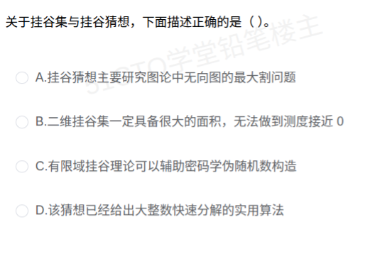

# 备考笔记：挂谷集与挂谷猜想

## 一、题目

> 关于挂谷集与挂谷猜想，下面描述正确的是（ ）。
>
> A. 挂谷猜想主要研究图论中无向图的最大割问题
> B. 二维挂谷集一定具备很大的面积，无法做到测度接近 0
> C. 有限域挂谷理论可以辅助密码学伪随机数构造
> D. 该猜想已经给出大整数快速分解的实用算法

**答案：C. 有限域挂谷理论可以辅助密码学伪随机数构造**

解析：挂谷集（Kakeya 集，又称 Besicovitch 集）是**包含指向每一个方向的单位线段**的集合，属**几何测度论**而非图论。Besicovitch 证明平面挂谷集的**面积（勒贝格测度）可以为 0**——B 直接与这一反直觉经典结论相反。挂谷猜想的正确表述是"挂谷集的 **Hausdorff 维数**必须等于空间维数 n"，它关心**维数下界**而不是面积。C 正确：2008 年 Dvir 用**多项式方法**证明了有限域上的挂谷猜想，该方法随后成为构造**随机性提取器、合并器（merger）**等伪随机对象的核心工具，而伪随机数构造正是密码学的基础设施。D 是"数学前沿=能破密码"的联想陷阱：大整数分解的实用算法是数域筛（经典）与 Shor 算法（量子），挂谷猜想从未给出任何分解算法。

## 二、知识点：挂谷集与挂谷猜想

### 1. 核心原理

**（1）问题的起源——"转针问题"**：1917 年日本数学家挂谷宗一（Kakeya Sōichi）问：一根单位长度的针在平面上**掉转一整圈（360°）**，扫过的最小面积是多少？

**（2）挂谷集（Kakeya 集 / Besicovitch 集）**：平面中**包含每个方向上的单位线段**的点集。等价说法：这根针在每个朝向上都能"躺进"该集合。

**（3）反直觉经典结论（Besicovitch，1919/1928）**：挂谷集的面积可以**任意小，甚至测度为 0**——通过把三角形反复切分、旋转、平移重叠（"Perron 树"构造），针扫过的总面积可压缩到零。故 B 错误。

**（4）挂谷猜想（Kakeya conjecture）**：n 维欧氏空间 Rⁿ 中的挂谷集虽然**测度可为 0**，但其 **Hausdorff 维数必须为 n**（"维数顶满"）。注意区分两个概念：

- 测度（面积/体积）可以为 0 ✔（已证明）
- 维数必须达到 n ✔（n=2 已证明；n≥3 长期未决）

**（5）有限域版本与多项式方法**：把 Rⁿ 换成有限域向量空间 F_qⁿ，挂谷集 = 包含**每个方向各一条完整直线**的集合。2008 年 Dvir 用**多项式方法**一举证明有限域挂谷猜想：若集合太小，则可构造一个低次多项式在其上处处为零 → 由"每方向都有直线上的 q 个零点"推出多项式恒为零 → 与所取非零多项式矛盾 → 集合规模必有 Ω(qⁿ) 下界。

**（6）与密码学/理论计算机的联系**：Dvir 的多项式方法迅速扩散为构造**随机性提取器（extractor）与合并器（merger）**的标准工具（如 Dvir–Wigderson："Kakeya sets, new mergers and old extractors"），这些伪随机对象是**伪随机数生成、去随机化**乃至密码学构造的理论基石——C 正确。

### 2. 关键公式/规则

| 名称 | 内容 | 对应选项 |
| --- | --- | --- |
| 挂谷集定义 | 包含**每个方向**单位线段（有限域下为每方向一条直线）的集合 | — |
| 所属学科 | 几何测度论 / 调和分析，**不是图论** | A ✘ |
| Besicovitch 结论 | 平面挂谷集**测度可为 0**（面积任意小） | B ✘ |
| 挂谷猜想 | 挂谷集 **Hausdorff 维数 = n**（n=2 已证，三维 2025 年宣布解决） | — |
| 有限域挂谷定理 | Dvir（2008）多项式方法证明：‖挂谷集‖ ≥ C·qⁿ | — |
| 应用出口 | 多项式方法 → 提取器/合并器 → **伪随机数构造** | C ✔ |
| 大整数分解 | 实用算法 = 数域筛 / Shor 算法，与挂谷无关 | D ✘ |

### 3. 解题步骤

1. **识别题型**：科技前沿动态记忆题，无计算，靠"定义 + 核心结论 + 应用方向"三条线排除。
2. **排除 A**：挂谷属几何测度论；"最大割（max-cut）"是 NP 难的图论组合优化问题，词面陷阱。
3. **排除 B**：与 Besicovitch"测度为 0"的百年经典结论正面冲突；且猜想的核心是**维数**而非面积。
4. **确认 C**：有限域挂谷 + 多项式方法 → 随机性提取器/合并器 → 伪随机数与密码学构造，链条真实成立。
5. **排除 D**：大整数分解的进展来自数域筛与量子 Shor 算法，挂谷猜想没有产生任何分解算法。

## 三、易错点

1. **被 A 的"割"字带偏**：max-cut 是图论术语；挂谷问题里"针/线段"与图论无关，看到"最大割"直接排除。
2. **凭生活直觉选 B**："针转一圈总得占地方"——恰恰错，Besicovitch 的反直觉构造正是本题最大的知识盲区：面积可无限小、测度为 0。
3. **混淆"测度 0"与"维数 n"**：测度衡量"体积"，Hausdorff 维数衡量"稀疏程度"，二者独立。挂谷集可以"体积为零但维数顶满"，猜想只对后者下结论。
4. **被 D 的密码联想迷惑**："前沿数学 = 破解 RSA"是常见脑补；分解大整数的实用算法是数域筛（经典）与 Shor 算法（量子），任何"猜想被证明"都不会自动变成分解算法。
5. **冷门前沿题的答题策略**：此类题通常仅 1 分且无法推导，靠积累；记忆口诀——**挂谷集：每方向一根针；猜想：测度可零、维数必满；应用：有限域 + 多项式方法 → 伪随机**。

## 四、扩展延伸

- **带约束的转针问题**：若要求针转过的区域是**凸集**，最小面积是**等边三角形**（面积 √3/4）；不要求凸时答案才是"测度 0"。这一对比最能帮助理解"去约束 → 反直觉"。
- **研究前沿**：三维（乃至一般 n 维）挂谷猜想长期是调和分析核心难题；2025 年初，王虹与 Joshua Zahl 宣布完成**三维挂谷猜想**的证明（体积估计路线），被广泛视为重大突破。考试若再考，留意"二维已证、三维已宣布解决、高维开放"这一状态线。
- **与调和分析的联动**：挂谷猜想与**限制性估计（restriction estimates）、Bochner-Riesz 求和收敛性、局部光滑性估计**等核心问题深度互证（Bourgain、Tao 等人的工作链），是"一个组合几何问题牵动整个分析学科"的典范。
- **多项式方法的谱系**：有限域挂谷（Dvir）→ 乘积定理（Guth–Katz 用于 Cordoba 投影问题与 Erdős 距离问题）→ 列表译码、提取器构造。这条"组合几何 → 多项式 → 伪随机/编码"的传导链是命题人最爱设置"应用方向"选项的素材库。
- **同族前沿考点对照**：NP 完全（计算复杂性）、P vs NP、量子计算 Shor/Grover、零知识证明——都属"知道结论和应用方向即可"的记忆型考点，不必深究证明。

## 五、错题归档

| 题号 | 题型 | 考点 | 难度 | 掌握度 |
| --- | --- | --- | --- | --- |
| 新技术与前沿动态 | 单选 | 挂谷集定义（每方向单位线段）、测度 0 与维数 n 的区分、有限域挂谷 + 多项式方法 → 伪随机构造 | 难 | 待复习 |

（重做本题时在表尾追加 `重做 N` 行，见「步骤 2.5 重做留痕」）

## 六、相关图片

原题截图：`../images/133-挂谷集与挂谷猜想.png`（由用户上传的原题图复制改名而来）

