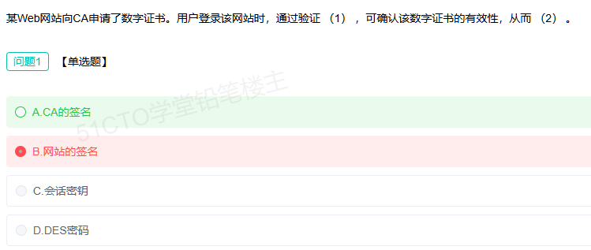

# 备考笔记：数字证书验证-CA签名

## 一、题目

> 某Web网站向CA申请了数字证书。用户登录该网站时，通过验证（1），可确认该数字证书的有效性，从而（2）。
>
> 【单选题】
> A. CA的签名
> B. 网站的签名
> C. 会话密钥
> D. DES密码

**答案：A. CA的签名**

解析：数字证书由 CA（证书颁发机构）签发——CA 用**自己的私钥**对"网站公钥 + 主体信息"做数字签名写进证书。用户验证证书时，用**CA 的公钥**（预置在浏览器/系统的根证书中）解签并比对摘要，签名正确即说明证书**未被篡改且确由可信 CA 签发**，从而确认证书有效、可信任其中的网站公钥，进而确认网站身份（防冒充、防中间人）。

本次误选 B"网站的签名"：网站不能自证——证书的意义正是靠**第三方 CA 背书**，若验的是网站自己的签名就退化成了"自己给自己开证明"。C 会话密钥、D DES 密码都属于**数据加密**范畴，与"证书有效性验证"无关。

## 二、知识点：数字证书验证-CA签名

### 1. 核心原理

**数字证书 = 网站公钥 + 主体信息（域名、有效期等） + CA 的数字签名**，遵循 X.509 标准，由 PKI（公钥基础设施）体系管理。

- **签发**：CA 对证书内容求摘要，用 **CA 私钥**加密摘要 → 签名；
- **验证**：用户端用 **CA 公钥**解签得到摘要，与本地对证书内容重新计算的摘要比对，**一致则证书有效**；
- **信任链**：根 CA → 中间 CA → 网站证书，逐级用上级 CA 的公钥验签（自签名的根证书预置在操作系统/浏览器中）。

一句话口诀：**"CA 私钥签、CA 公钥验；谁签发验谁"**。

### 2. 关键公式/规则

| 环节 | 使用的密钥 | 作用 |
| --- | --- | --- |
| CA 签发证书 | **CA 私钥** | 对证书内容签名，赋予权威性 |
| 用户验证证书 | **CA 公钥** | 验签 → 确认证书有效、未篡改 |
| 网站身份证明 | **网站私钥**（HTTPS 握手签名） | 证明"我确实是这个网站" |
| 数据加密传输 | **会话密钥**（对称） | 与证书验证无关 |

### 3. 解题步骤

1. **抓题眼**：题干问"验证……确认**数字证书的有效性**"——属 PKI/数字签名验证，不是数据加密。
2. **定签发关系**：证书是 **CA 向网站签发**的 → 签名是 **CA 的签名** → 验证即"验 CA 的签名"。
3. **逐项排除**：
   - B 网站的签名 → 网站不能为自己的证书背书（自证无效）✗；
   - C 会话密钥 → 用于**加密通信数据**，不验证证书 ✗；
   - D DES 密码 → 对称加密算法，与证书验证无关 ✗。
4. **选定 A**。

## 三、易错点

1. **混淆"验谁的签名"**：验证证书验的是 **CA 的签名**（用 CA 公钥），不是网站的签名。网站签名用于证明"数据是网站发的"（身份/抗抵赖），不能证明证书本身有效。
2. **混淆"身份验证"与"数据加密"**：会话密钥、DES/3DES/AES 是**加密**手段；证书验证属于**认证（真实性）**，两者别混。
3. **HTTPS 握手两阶段别倒置**：先**验证数字证书**（确认网站身份），再协商**会话密钥**（加密数据）——顺序是"先认证、后加密"。
4. **摘要算法归错队**：MD5/SHA/SM3 是**单向散列（Hash）**，既非对称也非非对称加密；签名 = 摘要 + 非对称加密。
5. **以为"证书有效 = 网站可信"**：证书有效只说明身份真实，还需看**有效期、域名匹配、是否被吊销（CRL/OCSP）**——证书也可能过期或被吊销。

## 四、扩展延伸

- **HTTPS/TLS 握手主线**（与 54 对称加密、58 安全分类串起来考）：
  1. 客户端请求 → 服务器出示**数字证书**；
  2. 客户端用 **CA 公钥验证签名**、校验域名与有效期 → 确认网站身份；
  3. 双方协商/交换**会话密钥**（非对称传钥匙）；
  4. 后续数据用**对称加密**（AES）+ **消息摘要**保证机密性与完整性。
  一句话：**"证书管身份，对称管数据，摘要管完整"**。
- **PKI 组成**：CA（证书颁发）、RA（注册审核）、证书库（目录）、CRL/OCSP（吊销状态）、端实体。
- **易混概念对照**：
  - **数字签名**：私钥签、公钥验 → 抗抵赖 + 完整性；
  - **数字证书**：把"公钥是谁的"交给 CA 盖章 → 解决公钥**可信分发**问题；
  - **报文认证（MAC）**：共享密钥算校验值 → 完整性 + 认证，**无抗抵赖**。
- **现实类比**：证书就像 CA 盖钢印的"身份证复印件"——你核对**钢印真伪**（验 CA 签名）确认复印件有效，再对照**照片与本人**（HTTPS 中用网站公钥加密握手消息）确认眼前的人就是网站本人。

## 五、错题归档

| 题号 | 题型 | 考点 | 难度 | 掌握度 |
| --- | --- | --- | --- | --- |
| 系统分析师-网络与信息安全 | 单选 | 数字证书验证：**验证 CA 的签名**（CA 私钥签、CA 公钥验） | 易 | 薄弱（本次错选 B） |
| 系统分析师-网络与信息安全 | 单选 | 身份认证（证书）vs 数据加密（会话密钥/DES）的范畴区分 | 易 | 待复习 |
| 系统分析师-网络与信息安全 | 单选 | PKI/信任链、HTTPS 握手"先认证后加密"顺序 | 中 | 待复习 |

## 六、相关图片

原题截图：`../images/134-数字证书验证-CA签名.png`（由用户上传的原题图复制改名而来）

