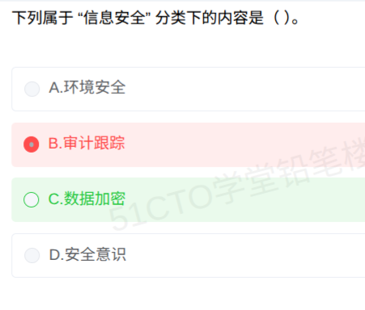

# 备考笔记：信息系统安全分类-信息安全与数据加密

## 一、题目

> 下列属于"信息安全"分类下的内容是（ ）。
>
> A. 环境安全
> B. 审计跟踪
> C. 数据加密
> D. 安全意识

**答案：C. 数据加密**

解析：信息系统安全按"保护什么、用什么手段保护"划分为**物理安全、运行安全、信息安全（数据安全）、管理安全（人员安全）**四层。各选项分属不同层：**环境安全**属**物理安全**；**审计跟踪**属**运行安全**；**数据加密**属**信息安全**；**安全意识**属**管理安全**。题干问"信息安全"，故选 **C**。

## 二、知识点：信息系统安全分类-信息安全与数据加密

### 1. 核心原理

**信息安全**是信息系统安全四层分类中的**数据层**，保护对象是**数据本身（存储与传输中的机密性、完整性、可用性）**，典型内容包括：

- **数据加密**（保机密性，标志性内容）
- 数据完整性校验、防篡改
- 身份认证、数字签名
- 访问控制

四层全景（与 58 号笔记为姊妹题，仅题干限定词不同）：

- **物理安全**：保护硬件实体与运行环境，环境安全、设备安全、媒体安全；
- **运行安全**：保护系统运行过程，审计跟踪、备份与恢复、防病毒、应急响应；
- **信息安全**：保护数据本身，**数据加密**、认证、访问控制、签名；
- **管理安全**：靠制度与人员保障，安全意识教育、管理制度、合规。

一句话记忆：**物理管"房子"，运行管"跑"，信息管"料"，管理管"人"**。本题问的是"料"，所以选**数据加密**。

### 2. 关键公式/规则

| 层次 | 保护对象 | 典型内容 |
| --- | --- | --- |
| **物理安全** | 硬件实体与机房环境 | 环境安全、设备安全、媒体安全、门禁/消防/防雷 |
| **运行安全** | 系统运行过程 | 审计跟踪、备份与恢复、防病毒、应急响应 |
| **信息安全** | 数据本身（存储与传输） | **数据加密**、完整性校验、身份认证、访问控制、数字签名 |
| **管理安全** | 制度与人员 | 安全意识教育、安全管理制度、人员权限、合规 |

> 关键区分：**"数据加密"是信息安全的标志性内容**，它直接作用于数据机密性；而"审计跟踪"作用于运行过程记录、"环境安全"作用于机房实体，都与数据本身无关。

### 3. 解题步骤

1. **抓题干限定词**：问的是"**信息安全**"分类下，不是"运行安全"、更不是"信息系统安全"整体。
2. **回放四层分类**：物理 / 运行 / 信息（数据）/ 管理。
3. **逐项归层**：
   - A 环境安全 → **物理安全** ✗；
   - B 审计跟踪 → **运行安全** ✗；
   - C 数据加密 → **信息安全** ✓；
   - D 安全意识 → **管理安全** ✗。
4. **选定 C**。

## 三、易错点

1. **姊妹题惯性陷阱（本题真实踩坑）**：同一组选项，上一题问"运行安全"选审计跟踪（B），本题题干换成"信息安全"，答案即变为数据加密（C）。**选项一字未动，题干一动答案全变**。必须逐字重读题干限定词，不能靠背"上一题选什么"。
2. **"信息安全"与"信息系统安全"整体混淆**：信息系统安全是**总称**（含物理、运行、信息、管理四层）；"信息安全"只是其中**管数据的那一层**。题干问的是分类下的"一层"，不要把总称当层名。
3. **"环境安全"误判**：环境安全（机房温湿度、防雷防火、门禁）明确属**物理安全**，四个选项里它离"信息"最远。
4. **"审计跟踪"惯性误选**：审计跟踪是运行安全的标志性内容，若上一题刚做过"运行安全选审计跟踪"，本题极易手滑再选 B。
5. **"安全意识"错当技术措施**：安全意识、培训、制度属**管理安全**，与数据加密的技术手段不同层。
6. **只记"加密=安全"的反向误用**：数据加密只覆盖信息安全一层，不能包打四层；反过来，四层中只有信息安全层的标志性内容才是加密。

## 四、扩展延伸

- **口径对照**：经典教材四分法为"实体安全（物理）、运行安全、信息安全、人员安全（管理）"；部分教材把"信息安全"层写作"数据安全"，两者同义，看到任一口径都指向**数据加密、认证、访问控制、签名**。
- **CIA 三元组锚定**：信息安全层的保护目标即**机密性（加密）、完整性（校验/签名）、可用性（备份/容灾）**。题干问"信息安全"时，优先找直接作用于 CIA 的技术。
- **四选项快速定位口诀**：**环境→物理，审计→运行，加密→信息，意识→管理**。八个字解决这一族全部变式题。
- **与 58 号笔记对照复习**：58 题问"运行安全"选 B 审计跟踪；本题问"信息安全"选 C 数据加密。建议两笔记连着看，专门训练"题干限定词敏感性"。
- **现实类比**：
  - **物理安全**＝锁好大楼门禁与消防；
  - **运行安全**＝监控摄像头与值班日志，跑着的东西看得见、查得到；
  - **信息安全**＝把金库里的钱**加密上锁**，谁动过都有签名；
  - **管理安全**＝员工守则与安全培训，机器再好，人乱来一样出事。

## 五、错题归档

| 题号 | 题型 | 考点 | 难度 | 掌握度 |
| --- | --- | --- | --- | --- |
| 系统分析师-网络与信息安全 | 单选 | 信息系统安全四层分类：**信息安全层含数据加密**；环境安全属物理、审计跟踪属运行、安全意识属管理 | 易 | 薄弱（误选 B，姊妹题惯性陷阱） |

（重做本题时在表尾追加 `重做 N` 行，见「步骤 2.5 重做留痕」）

## 六、相关图片

原题截图：`../images/136-信息系统安全分类-信息安全与数据加密.png`（由用户上传的原题图复制改名而来）

