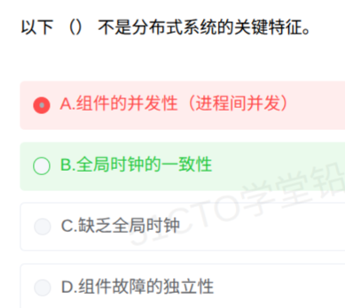

# 备考笔记：分布式系统-关键特征辨析

## 一、题目

> 以下（  ）不是分布式系统的关键特征。
>
> A. 组件的并发性（进程间并发）
> B. 全局时钟的一致性
> C. 缺乏全局时钟
> D. 组件故障的独立性

**答案：B. 全局时钟的一致性**

解析：分布式系统的经典定义（Tanenbaum）：**网络互连的独立计算机的集合，对用户与应用程序呈现为单个连贯的系统**。其关键特征包括：**组件的并发性**（多台机器上的进程并发执行，A 正确）、**缺乏全局时钟**（各节点时钟漂移、无法完全同步，C 正确）、**组件故障的独立性**（部分失效不影响全局，D 正确）。而 **B「全局时钟的一致性」恰与 C 互为反义**：分布式系统根本不存在一致的全局时钟，正因如此才有 C 这一特征，故「不是」的是 B。

## 二、知识点：分布式系统的关键特征

### 1. 核心原理

分布式系统不是"多台机器的简单堆叠"，其本质约束是：**各节点物理上独立、通过消息传递协作**，由此派生出三大关键特征：

- **组件的并发性**：系统由分布在不同机器上的进程组成，**进程间天然并发执行**，靠消息传递同步，不是单机内的线程调度。
- **缺乏全局时钟**：网络延迟与时钟漂移使**各节点的物理时钟无法保证一致**，系统内**没有统一的"现在"**；事件排序只能靠**逻辑时钟（Lamport 时钟）、向量时钟**等机制近似实现。
- **组件故障的独立性（部分失效）**：一个节点的崩溃**不会立即导致整个系统崩溃**，故障被隔离在局部；这也带来了"检测某个节点是否失效"本身就很困难的判定问题。

此外教材常并列的特征还有：**透明性**（用户感知不到节点位置、副本、迁移等分布细节）、**可扩展性**（规模增大时性能不至于崩溃）。

一句话锚点：**"并发执行、无统一钟、坏了不连坐。"**

### 2. 关键公式/规则

**特征与反义陷阱对照表（否定式命题的设陷点）：**

| 关键特征 | 对应的反义陷阱选项 |
| --- | --- |
| 组件的并发性（进程间并发） | "节点互斥执行""系统串行运行" |
| **缺乏全局时钟** | **"全局时钟的一致性""各节点时钟完全同步"**（本题 B） |
| 组件故障的独立性 | "单点故障导致全局崩溃""故障全局传播" |
| 对用户透明 | "用户必须知道数据存放的节点" |

**本题选项定位：**

| 选项 | 判定 | 说明 |
| --- | --- | --- |
| A. 组件的并发性（进程间并发） | **是特征** | 括号注释是干扰，并发性正是靠进程间并发实现 |
| **B. 全局时钟的一致性** | **不是** | 与 C 互为反义，分布式系统恰恰缺乏全局时钟 |
| C. 缺乏全局时钟 | 是特征 | 教材原表述 |
| D. 组件故障的独立性 | 是特征 | 部分失效是分布式系统标志性属性 |

### 3. 解题步骤

1. **圈否定词**：题干问"**不是**"，选 exempts 项而非特征项。
2. **验对偶**：发现 B 与 C 互为反义，单选题中**对偶二选一必有一假**；C 是教材原表述 → 假的是 B。
3. **正向复核**：A（并发）、D（故障独立）均为经典特征，排除。
4. **锁定 B**。

## 三、易错点

1. **被 A 的括号"（进程间并发）"带偏**：看到"进程"以为是单机操作系统概念而排除 A。实际上**分布式系统的并发性正是通过不同机器上的进程并发体现**，括号是正确注释，不是干扰信息。
2. **忽视 B/C 的对偶关系**：单选题中出现一对互为反义的选项，先做"二选一必有一假"的判定，可秒杀本题；逐项独立分析反而容易绕晕。
3. **把"缺乏全局时钟"记反**：误以为系统会提供统一时钟服务。**物理上做不到**，只能靠 Lamport 逻辑时钟、向量时钟做**事件偏序**，NTP 同步也有毫秒级漂移。
4. **混淆"故障独立性"与"系统高可用"**：故障独立性说的是**故障域局部化**（坏一个不连坐全部），并不承诺系统整体不宕机；高可用是靠冗余 + 故障转移**利用**这一特征实现的目标。

## 四、扩展延伸

- **为什么"缺乏全局时钟"是本质约束**：相对论层面就不存在跨节点的统一"同时"；工程上网络延迟不可测（无同步网络假设），因此分布式算法（如 Lamport 时钟）只追求**因果序/偏序**而非全局时刻，这是后续一致性协议、分布式锁的基础。
- **三大特征与分布式难题的对应**：并发性 → **并发控制与竞态**；缺乏全局时钟 → **事件排序、超时误判**；故障独立性 → **部分失效下的容错（CAP、Paxos/Raft 解决的正是这类问题）**。
- **易混概念对比**：
  - **集群（Cluster）**：同构多机对外像一台机器，强调**高可用/负载均衡**，是分布式系统的一种工程形态（见 [65-负载均衡-分类与集群实现方案.md](65-负载均衡-分类与集群实现方案.md)）；
  - **分布式数据库**：焦点在**数据分片与分布透明性**（见 [23-分布式数据库-分布透明性层次.md](23-分布式数据库-分布透明性层次.md)、[16-分布式数据库-CAP理论.md](16-分布式数据库-CAP理论.md)）；
  - **微服务**：架构层面的"分布式化"，其特征（独立部署、故障隔离）与分布式系统三特征同源（见 [32-微服务系统特征.md](32-微服务系统特征.md)）。
- **现实类比**：**一支没有统一秒表的交响乐团**，各声部**并发演奏**（并发性）；乐手之间**没有共同的钟**，靠指挥手势与节拍近似对齐（缺乏全局时钟，节拍器≈逻辑时钟）；一位小提琴手断了一根弦**不影响长笛继续吹**（故障独立性）。

## 五、错题归档

| 题号 | 题型 | 考点 | 难度 | 掌握度 |
| --- | --- | --- | --- | --- |
| 系统分析师-网络 | 单选 | 分布式系统关键特征：组件并发、缺乏全局时钟、故障独立；"全局时钟一致性"为反义陷阱 | 易 | 误选 A |

## 六、相关图片

原题截图：`../images/137-分布式系统-关键特征辨析.png`（由用户上传的原题图复制改名而来）

