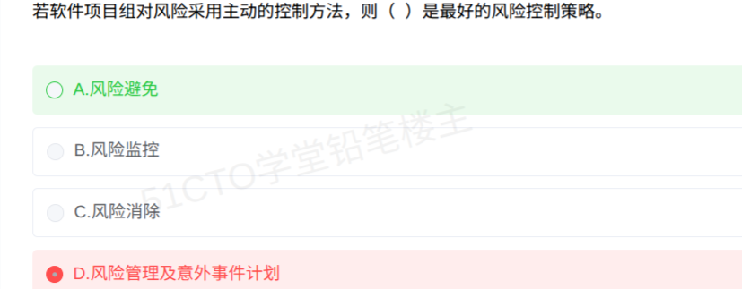

# 备考笔记：风险控制三策略与主动被动辨析

## 一、题目

> 若软件项目组对风险采用主动的控制方法，则（ ）是最好的风险控制策略。
> A. 风险避免
> B. 风险监控
> C. 风险消除
> D. 风险管理及意外事件计划

**答案：A. 风险避免**

解析：风险控制有三种策略：**风险避免、风险监控、风险管理及意外事件计划**。"主动的控制方法"指在技术工作开始之前就识别风险、评估风险并设法消除风险源，使风险根本不发生或其后果不伤及项目，这正是"风险避免"的内涵，故主动方法下**风险避免**是最好的策略。"风险管理及意外事件计划"是风险成真之后的补救性兜底安排，层次低于避免，属于被动依赖的手段。

## 二、知识点：风险控制三策略与主动被动辨析

### 1. 核心原理

风险管理的落脚点是**风险控制**，教材给出三种常用策略：

| 策略 | 做法 | 角色定位 |
| --- | --- | --- |
| **风险避免** | 变更项目计划，**消除风险本身**或使其后果不伤及项目（放弃高风险技术方案、隔离不明确需求等） | **主动方法下的最优策略** |
| **风险监控** | 项目进行中持续跟踪风险征兆、定期再评估、监视触发条件 | 全程跟踪手段，不消除风险 |
| **风险管理及意外事件计划** | 假设风险会发生，预先编制应急预案，风险成真时启动补救 | 风险发生后的兜底安排 |

主动与被动的分野（Pressman）：

1. **主动策略**：技术工作开始前就识别潜在问题、排定优先级、写入项目计划并持续跟进，目标是"不让风险变成问题"。教材结论：**避免是最好的策略**。
2. **被动策略**：事前无所作为，等风险变成问题才行动，此时主要依赖**意外事件计划**补救。

### 2. 关键公式/规则

| 命题 | 结论 |
| --- | --- |
| 采用主动控制方法 | 最好的策略 = **风险避免** |
| 采用被动控制方法 | 主要依赖风险管理及意外事件计划 |
| 风险控制三策略 | 风险避免、风险监控、风险管理及意外事件计划 |

### 3. 解题步骤

1. 抓题眼："主动的控制方法"，对应"**事前消除风险源**"。
2. 排除生造术语：三策略清单里没有"风险消除"，非常规术语先怀疑是干扰项。
3. 层次比较：避免（不让发生）> 监控（只跟踪）> 意外事件计划（事后补救），主动方法取最优层，即风险避免。

## 三、易错点

1. **直觉陷阱（本题踩坑点）**：D"风险管理及意外事件计划"字面上最像"主动"（又是管理又是计划），但它是风险成真后的补救预案；主动方法的最高目标是"让风险不发生"，故选风险避免。
2. **"风险消除"是生造干扰项**：教材三策略中只有"风险避免"，没有"风险消除"这个标准术语。
3. **把"风险监控"当最优**：监控只是跟踪风险征兆，不改变风险本身，谈不上"最好"。
4. **主动、被动配对记反**：主动配"避免"，被动靠"意外事件计划"兜底。
5. **与 PMBOK 应对四策略混淆**：本题考软件工程口径的"风险控制三策略"，不是项目管理的"规避/转移/减轻/接受"。

## 四、扩展延伸

- Pressman 原话：If a software team adopts a **proactive** approach to risk, **avoidance is the best policy**。
- 风险避免的常见做法：放弃采用不成熟的新技术、改用成熟框架、隔离不明确的需求、缩小项目范围等。
- 意外事件计划（contingency plan）：为重要风险定义**触发条件（阈值）**，一旦触发即启动回退、备份、降级方案。
- 与 PMBOK 对照：风险应对四策略为**规避、转移、减轻、接受**，本题的"风险避免"对应其中的"规避"。
- 现实类比：主动控制＝出门前看天气预报，有雨就改期出行（避免淋雨）；被动控制＝照常出门，带伞还备一套换洗衣服（事后补救）。
- 关联笔记：[91-项目风险管理-论文写作要点](91-项目风险管理-论文写作要点.md)（风险管理五过程与应对四策略）。

## 五、错题归档

| 题号 | 题型 | 考点 | 难度 | 掌握度 |
| --- | --- | --- | --- | --- |
| 139 | 单选 | 风险控制三策略清单与主动被动对应关系 | 易 | 薄弱（误选D） |

（重做本题时在表尾追加 `重做 N` 行，见「步骤 2.5 重做留痕」）

## 六、相关图片

原题截图：`../images/139-风险控制-三策略与主动被动辨析.png`（由用户上传的原题图复制改名而来）

