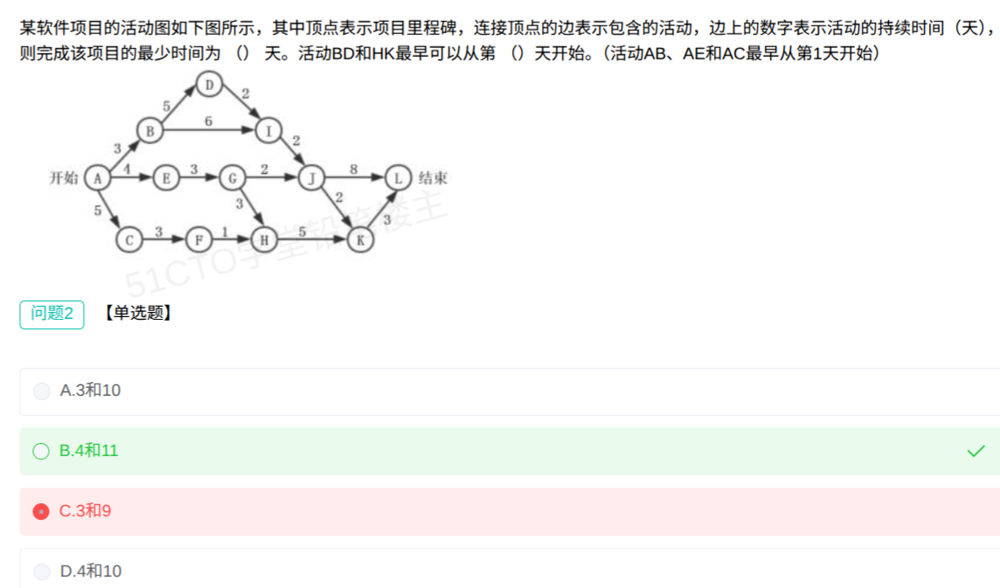

# 备考笔记：活动图-关键路径与最早开始时间

## 一、题目
> 某软件项目的活动图如下图所示，其中顶点表示项目里程碑，连接顶点的边表示包含的活动，边上的数字表示活动的持续时间（天），则完成该项目的最少时间为（）天。活动BD和HK最早可以从第（）天开始。（活动AB、AE和AC最早从第1天开始）
> A. 3和10
> B. 4和11
> C. 3和9
> D. 4和10

**答案：B. 4和11**

说明：本题截图为问题2，只考第二个空（BD、HK 的最早开始天）；第一个空「最少时间 = 20 天」属于问题1，一并整理在笔记中。

## 二、知识点：活动图（AOA 双代号网络图）时间参数计算

### 1. 核心原理
- 顶点 = 里程碑，边 = 活动，边权 = 持续时间。
- 里程碑最早时刻 = 所有流入活动中「起点时刻 + 持续时间」的**最大值**（多条流入边取 max，缺一不可）。
- 起点约定：题干「活动AB、AE和AC最早从第1天开始」⇒ 里程碑 A 的时刻为 0；由此推出通用规则：**活动最早开始天 = 其起始里程碑最早时刻 + 1**（里程碑在第 X 天末到达，活动第 X+1 天开始）。
- 项目最少完成时间 = 终点里程碑最早时刻 = 关键路径长度。

### 2. 关键公式/规则
| 名称 | 表达式 |
| --- | --- |
| 里程碑最早时刻 | ES(节点) = max( ES(前驱) + d(边) )，多流入取最大 |
| 活动最早开始天 | 起点里程碑最早时刻 + 1 |
| 项目最少工期 | 终点最早时刻 = 关键路径累计时长 |

### 3. 解题步骤
1. 定基准：A 时刻 0（AB/AE/AC 第 1 天开始）。
2. 逐节点正推，多流入取 max：
   - B=3，E=4，C=5
   - D=B+5=8；I=max(B+6=9, D+2=10)=**10**
   - G=E+3=7；F=C+3=8；H=max(F+1=9, G+3=10)=**10**
   - J=max(I+2=12, G+2=9)=12；L=J+8=20；K=max(H+5=15, J+2=14)=15
3. 最少时间：结束=max(L=20, K+3=18)=**20 天**，关键路径 A→B→D→I→J→L（3+5+2+2+8）。
4. 换算开始天：BD 从 B 出发，3+1=**第 4 天**；HK 从 H 出发，10+1=**第 11 天**。

## 三、易错点
1. **忘加 1**：把「里程碑第 3 天末到达」直接当成「活动第 3 天开始」。题干「最早从第 1 天开始」已暗示换算规则：A 时刻 0 → 第 1 天，同理 B 时刻 3 → 第 4 天。误选 C 的「3」即此错。
2. **漏流入边**：H 的流入有 F→H(1) 和 G→H(3) 两条，必须取 max(9,10)=10；只算 C→F→H 路径得 9 就错。同理 I 的流入有 B→I(6) 和 D→I(2)，取 max(9,10)=10，漏掉 D→I 会连锁把 J 算小。误选 C 的「9」是「漏 G→H 边 + 忘加 1」双重错误叠加。
3. **关键路径靠目测**：路径多且分叉汇交时，必须逐节点正推，不能凭「看起来最长」的那条。

## 四、扩展延伸
- 本图为 AOA（双代号：边是活动、点是里程碑）；另一类 AON（单代号：节点是活动、边是逻辑关系），算法规格相同，注意区分读图方式。
- 若问总时差 / 最晚开始时间：从终点逆推最晚时刻 LF，总时差 = LF − ES；总时差为 0 的活动串成关键路径。本题非关键活动如 AC（5）：C=5，后续 H=10，CF 无松弛？F=8、H=10，FH 可晚 1 天开始，总时差 1 天。
- 口诀：**「多流入取最大，开始天加一」**。

## 五、错题归档
| 题号 | 题型 | 考点 | 难度 | 掌握度 |
| --- | --- | --- | --- | --- |
| 1 | 单选 | 活动图最早开始时间计算（里程碑正推+1换算） | 中 | 薄弱（误选C） |

（重做本题时在表尾追加 `重做 N` 行，见「步骤 2.5 重做留痕」）

## 六、相关图片
原题截图：`../images/140-活动图-关键路径与最早开始时间.png`（由用户上传的原题图复制改名而来）

