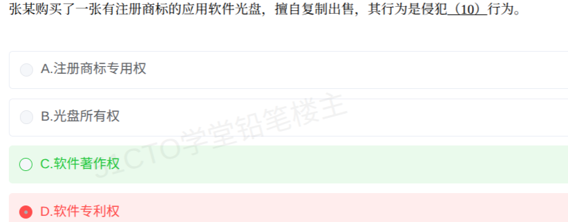

# 备考笔记：复制出售软件光盘侵权辨析

## 一、题目

> 张某购买了一张有注册商标的应用软件光盘，擅自复制出售，其行为是侵犯（10）行为。
>
> A. 注册商标专用权
> B. 光盘所有权
> C. 软件著作权
> D. 软件专利权

**答案：C. 软件著作权**

## 二、知识点：复制出售软件光盘的侵权对象辨析

### 1. 核心原理

**载体与作品二分**。购买软件光盘，买方取得的只是**这一张光盘（物质载体）的所有权**以及软件的合法使用权；软件的**著作权始终归开发者**，不随光盘买卖而转移。

张某的行为拆成两个动作看：

- **擅自复制**：未经著作权人许可复制软件，落入软件著作权的**复制权**控制范围；
- **出售**：向公众发行复制品，落入**发行权**控制范围。

依据《计算机软件保护条例》，未经许可复制、发行著作权人的软件即构成侵权，故张某侵犯的是**软件著作权**。

### 2. 关键规则

| 选项 | 权利客体 | 是否被侵犯 | 排除理由 |
| --- | --- | --- | --- |
| A 注册商标专用权 | 商标标识 | 否 | 张某复制的是软件作品，并非假冒注册商标制造、销售商品 |
| B 光盘所有权 | 光盘（载体） | 否 | 载体所有权只支持处分"这张盘"本身（转售原盘），复制其中的软件已超出载体范围 |
| C 软件著作权 | 软件作品 | **是** | 未经许可复制 + 发行，直接侵犯复制权、发行权 |
| D 软件专利权 | 专利技术方案 | 否 | 软件默认靠著作权保护，专利须申请授权，题干无任何专利信息 |

### 3. 解题步骤

1. **锁定行为**："擅自复制 + 出售"，对应著作权中的复制权与发行权两个权项；
2. **识别干扰**：题干特意强调"有注册商标"，属命题烟雾弹，张某的行为与商标无关；
3. **区分客体**：所有权的客体是光盘这张"塑料盘"，著作权的客体是软件作品（程序及其文档），复制行为指向后者；
4. **排除专利**：看到侵权不要想当然选专利权，先问"题干有没有专利授权的事实"。

## 三、易错点

1. **被"注册商标"带偏误选 A**：商标权保护的是**商标标识本身**。只有假冒该注册商标生产、销售商品才侵犯商标专用权；本题行为是复制软件，客体是作品不是商标。
2. **混淆载体所有权与作品著作权（误选 B 的根源）**：转卖、出借自己买的正版原盘不侵权（所有权处分 + 发行权用尽），但**复制后出售复制品**指向的是软件作品，与载体所有权无关。
3. **凭空套用专利权（误选 D 的根源）**：软件的法律保护默认方式是**著作权**（完成即自动取得）；专利须申请、审查、授权，题干毫无专利事实，选 D 属于"看到侵权就挑最高大上的权利"。
4. **权利用尽边界不清**："卖原盘"与"卖复制品"一字之差、结论相反，是这类题的永恒分水岭。

## 四、扩展延伸

- 《计算机软件保护条例》列举的典型侵权行为：未经许可**发表或登记**他人软件；**复制或部分复制**他人软件；向公众**发行、出租、通过信息网络传播**他人软件；**故意避开或破坏**著作权人为软件采取的技术措施等。
- 软件著作权主要权项：发表权、署名权、修改权、复制权、发行权、出租权、信息网络传播权、翻译权等。
- 合法持有人的边界：为防止复制品损坏可制作**备份复制品**，但不得提供给他人使用；为学习研究软件的设计思想和原理而使用，可不经许可、不付报酬。
- 现实类比：买了本书，这本书归你（载体所有权），转卖没问题（权利用尽）；但影印 100 本拿去卖，侵犯的是**著作权**，跟"书是你花钱买的"毫无关系。

## 五、错题归档

| 题号 | 题型 | 考点 | 难度 | 掌握度 |
| --- | --- | --- | --- | --- |
| 单选-复制出售软件光盘侵权辨析 | 单选 | 载体与作品二分：擅自复制并出售侵犯软件著作权（复制权+发行权）；商标权、载体所有权、专利权均为干扰项 | 易 | 薄弱 |
| 重做 1 | 单选 | 同该笔记主考点 | 同该笔记 | 重做 1-误选 D |

（重做本题时在表尾追加 `重做 N` 行，见「步骤 2.5 重做留痕」）

## 六、相关图片

原题截图：`../images/141-知识产权-复制出售软件光盘侵权辨析.png`（由用户上传的原题图复制改名而来）

