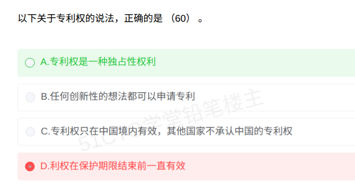

# 备考笔记：专利权特征辨析

## 一、题目

> 以下关于专利权的说法，正确的是（60）。
>
> A. 专利权是一种独占性权利
> B. 任何创新性的想法都可以申请专利
> C. 专利权只在中国境内有效，其他国家不承认中国的专利权
> D. 专利权在保护期限结束前一直有效

**答案：A. 专利权是一种独占性权利**

## 二、知识点：专利权的特征与授权条件辨析

### 1. 核心原理

专利权有三个法定特征：**独占性、地域性、时间性**，外加一道授权门槛：**三性条件**。四个选项各打一个点：

- **A 独占性（专有性）**：正确。同一发明创造只能授予一项专利权，专利权人对实施行为（制造、使用、许诺销售、销售、进口）享有排他权，未经许可任何人不得实施。这是专利权最本质的特征，表述平实、不带绝对化模态词。
- **B 授权门槛**："任何创新性的想法都可以申请专利"是全称命题，被两道门槛击穿：一是三性条件（新颖性、创造性、实用性），二是法定排除客体（科学发现、智力活动的规则和方法、疾病的诊断和治疗方法、动植物品种、原子核变换方法获得的物质等）。
- **C 地域性**："只在中国境内有效"符合地域性，但"其他国家不承认中国的专利权"后半句错。地域性的准确含义是各国专利制度相互独立，中国专利在他国不当然受保护，想获得保护须依《巴黎公约》、PCT 等另行申请，而不是"承认与否"的问题。
- **D 时间性**："保护期限结束前一直有效"错在"一直"。专利权不仅到期即灭（发明 20 年、实用新型 10 年、外观设计 15 年），保护期内还可能因未缴年费、书面声明放弃、被宣告无效而提前终止。

### 2. 关键规则

| 特征 | 准确表述 | 反例（推翻绝对化说法） |
| --- | --- | --- |
| 独占性 | 未经许可，他人不得以生产经营为目的实施专利 | 无（本题正确项） |
| 地域性 | 专利权仅在授予国境内有效，他国保护须另行申请 | 中国专利可经 PCT 在多国获得保护，不是"不承认" |
| 时间性 | 法定期限届满进入公有领域，期内可提前终止 | 发明专利第 3 年未缴年费即终止，任何人可自由实施 |
| 授权条件 | 新颖性、创造性、实用性，且不属于法定排除客体 | 新的棋类游戏规则属智力活动规则，不能授予专利 |

### 3. 解题步骤

1. **先扫模态词**：出现"任何""都""一直""不承认"的选项优先怀疑，构造一个反例即可推翻全称命题；
2. **逐一构造反例**：B 举"智力活动规则"，D 举"未缴年费提前终止"，C 挑出后半句的绝对化表述；
3. **选定平实项**：A 无任何模态词，说的正是专利权最本质的独占性，直接选。

## 三、易错点

1. **误选 D 的根源：把"时间性"简化成"倒计时"**。"在保护期限结束前一直有效"听着像常识，但专利权在保护期内随时可能中途夭折：未缴年费、书面声明放弃、被宣告无效都会提前终止。"一直"二字即陷阱。
2. **C 类"半真半假"选项**：前半句"只在中国境内有效"是地域性的正确表述，后半句"其他国家不承认"偷换概念。半真半假选项最容易蒙混过关，逐词核对是唯一解法。
3. **B 类"任何……都可以"**：全称命题 + 忽略法定排除客体。想到"科学发现不能授予专利"即可排除。
4. **反向排除法失灵**：本题正确项 A 看似"废话"，三个错误项反而都带细节。命题规律：不带模态词、不绝对化的平实表述，往往就是正确答案。

## 四、扩展延伸

- **三大特征口诀**：独占（排他实施）、地域（一国一权）、时间（到期入公）。
- **保护期限（自申请日起算）**：发明 20 年，实用新型 10 年，外观设计 15 年（2021 年《专利法》第四次修正）。
- **不授予专利权的客体**：科学发现；智力活动的规则和方法；疾病的诊断和治疗方法；动物和植物品种（生产方法除外）；原子核变换方法获得的物质；对平面印刷品起标识作用的设计。
- **先申请原则**：两个以上申请人分别就同样的发明创造申请专利的，专利权授予最先申请的人。
- **取得方式对比**：著作权自作品完成自动取得；专利权必须申请、审查、授权后才取得。相关辨析可参见 117 号笔记（算法成果保护方式）。

## 五、错题归档

| 题号 | 题型 | 考点 | 难度 | 掌握度 |
| --- | --- | --- | --- | --- |
| 单选-专利权特征辨析 | 单选 | 独占性、地域性、时间性三大特征的准确表述；授权三性与法定排除客体；用反例推翻"任何""一直"类全称命题 | 易 | 薄弱 |

（重做本题时在表尾追加 `重做 N` 行，见「步骤 2.5 重做留痕」）

## 六、相关图片

原题截图：`../images/142-知识产权-专利权特征辨析.png`（由用户上传的原题图复制改名而来）

