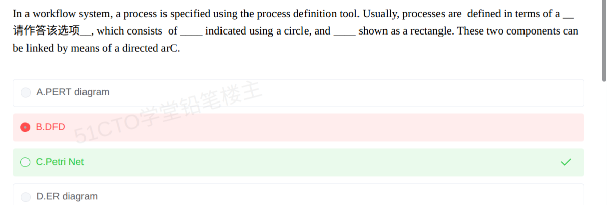

# 备考笔记：工作流过程定义-Petri网与DFD辨析

## 一、题目
> In a workflow system, a process is specified using the process definition tool. Usually, processes are defined in terms of a __（请作答该空）__, which consists of ___ indicated using a circle, and ___ shown as a rectangle. These two components can be linked by means of a directed arc.
> A. PERT diagram
> B. DFD
> C. Petri Net
> D. ER diagram

**答案：C. Petri Net**（本次误选 B）

## 二、知识点：工作流过程定义-Petri网与DFD辨析

### 1. 核心原理
工作流系统中，**过程定义工具（process definition tool）**用来形式化描述业务流程，其主流方法是 **Petri 网**。题眼是三个图形指纹：**circle（圆圈）+ rectangle（矩形）+ directed arc（有向弧）**——这是 Petri 网"库所/变迁"结构的标志性画法：

- **库所（places）**：用**圆圈**表示，描述状态/条件；
- **变迁（transitions）**：用**矩形**表示，描述事件/活动；
- 二者必须**交替连接**（圆圈→箭头→矩形），不允许同类节点直连。

本题出自 2008 上半年系统分析师上午英语完形（71~75），问第 73 空"processes are defined in terms of a ___"→ **Petri Net**。

### 2. 关键公式/规则

| 工具 | 图形元素特征 | 建模用途 |
| --- | --- | --- |
| **Petri 网** | 圆圈=库所、矩形=变迁、有向弧连接 | 过程/状态建模（并发、异步），工作流过程定义 |
| DFD 数据流图 | 圆圈/圆角框=加工、矩形=外部实体、箭头=数据流 | 功能建模，描述数据在系统中的流动 |
| PERT 图 | 节点=事件、箭线=活动，带工期估算 | 项目进度计划与关键路径 |
| ER 图 | 矩形=实体、椭圆=属性、菱形=联系 | 数据库概念设计 |

记忆锚：**问"过程怎么定义"→ Petri 网；问"数据怎么流"→ DFD；问"进度怎么排"→ PERT；问"数据怎么建"→ ER。**

### 3. 解题步骤
1. 抓所问空：空 1 问"过程用什么**模型**定义"，后面空格描述其组成元素 → 先锁定图形特征。
2. 圆圈 + 矩形 + 有向弧的"两分节点"组合是 Petri 网独有指纹 → 选 C。
3. 排除干扰：DFD/ER 虽也有矩形，但无"圆圈=状态、矩形=事件"的两分结构；PERT 是进度网络图，与"过程定义工具"无关。

## 三、易错点
1. **DFD 与 Petri 网图形"撞脸"**（本次错因）：Yourdon 风格 DFD 的"加工"也画成圆圈（泡泡图），外部实体是矩形——图形元素高度相似。区分靠**语境**：题干说 "a process is specified / defined in terms of"，即对**过程本身**建模 → Petri 网；DFD 建模的是**数据流动**。
2. **联想错位**：看到 "workflow" 就联想到"流程图/PERT"，但工作流过程定义的形式化工具在教材中明确为 **Petri 网**，PERT 用于项目进度而非流程定义。
3. **同篇不同空**：同一篇 2008 英语完形，第 75 空考 "and ___ shown as a rectangle"（答案 transitions，形近词干扰），第 73 空考"定义工具本身"（答案 Petri Net）。做题时先定位所问空，两空答案不同。

## 四、扩展延伸
- **全空答案串**：71 workflow reference model → 72 workflow engines → 73 Petri Net → 74 places → 75 transitions。
- **Petri 网**：Carl Adam Petri 于 1962 年提出，可用四元组（库所集 P、变迁集 T、有向弧集 F、令牌 M）描述，擅长表达**并发、冲突、同步**，是工作流过程建模的常用形式化工具，也是 WFMC 工作流参考模型中过程定义的推荐方法。
- **相关既有笔记**：[110-工作流参考模型-Petri网过程定义英文辨析.md](110-工作流参考模型-Petri网过程定义英文辨析.md)（同篇第 75 空 transitions 考法）、[76-工作流参考模型-六大基本模块辨析.md](76-工作流参考模型-六大基本模块辨析.md)（WRM 六模块，含"过程定义工具"模块定位）。

## 五、错题归档
| 题号 | 题型 | 考点 | 难度 | 掌握度 |
| --- | --- | --- | --- | --- |
| — | 单选（英文题干） | 工作流过程定义工具：Petri 网与 DFD/PERT/ER 图形辨析 | 中 | 薄弱（误选 B） |

（重做本题时在表尾追加 `重做 N` 行，见「步骤 2.5 重做留痕」）

## 六、相关图片
原题截图：`../images/143-工作流过程定义-Petri网与DFD辨析.png`（由用户上传的原题图复制改名而来）

