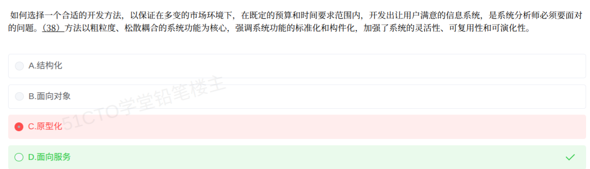

# 备考笔记：面向服务方法——粗粒度松耦合与构件化

## 一、题目

> 如何选择一个合适的开发方法，以保证在多变的市场环境下，在既定的预算和时间要求范围，开发出让用户满意的信息系统，是系统分析师必须要面对的问题。（38）方法以粗粒度、松耦合的系统功能为核心，强调系统功能的标准化和构件化，加强了系统的灵活性、可复用性和可演化性。
>
> A. 结构化
> B. 面向对象
> C. 原型化
> D. 面向服务

**答案：D. 面向服务**

解析：题干后半句是**教材原文定义**——"**以粗粒度、松耦合的系统功能为核心，强调系统功能的标准化和构件化，加强了系统的灵活性、可复用性和可演化性**"，这正是**面向服务（SO）方法**的标志性表述，选 D。四个开发方法各有自己的"招牌关键词"：**结构化**是"自顶向下、逐层分解"；**面向对象**是"对象、封装继承多态"；**原型化**是"需求不明确、快速构造原型让用户试用"；**面向服务**是"**粗粒度、松耦合、标准化、构件化**"。本题的判断落点全在后半句的特征定语上，与情境铺垫无关。

## 二、知识点：四种开发方法的特征辨析（开发方法选型）

### 1. 核心原理

软考教材（系统分析师 / 系统架构设计师）把主要开发方法并列对比，命题方式是**给出某种方法的特征描述，反指方法名**。四种方法的识别锚点：

| 方法 | 核心单元 | 招牌关键词 | 局限 |
| --- | --- | --- | --- |
| **结构化方法** | 功能（过程） | 自顶向下、逐层分解、数据流图 DFD、面向过程 | 需求变化时难适应，分析与设计"鸿沟" |
| **面向对象方法** | 对象 / 类 | 封装、继承、多态、消息传递，**细粒度**复用 | 复用停留在类级，跨系统集成弱 |
| **原型化方法** | 可运行原型 | **需求不明确**、快速构造、用户试用反馈 | 不涉及系统结构特征，易被当成品 |
| **面向服务方法** | **服务** | **粗粒度、松耦合、标准化、构件化**；灵活性、可复用性、可演化性 | 需接口契约与治理支撑（SOA/ESB） |

一句话锚点：**"粗粒度、松耦合、标准化、构件化"十二个字 = 面向服务**。这四个定语在教材中只用于描述面向服务方法，见到即锁答案。

粒度与耦合的演进光谱：**结构化（功能模块）→ 面向对象（类，细粒度）→ 面向服务（服务，粗粒度、松耦合）**——抽象层次越来越高，复用粒度越来越粗，与外部依赖越来越松。

### 2. 关键公式/规则

**特征定语匹配表（命题人取材自教材原文）：**

| 题干特征描述 | 指向的方法 |
| --- | --- |
| 自顶向下、逐层分解、数据流图 | 结构化 |
| 封装、继承、多态、对象 | 面向对象 |
| 需求不明确、快速原型、用户试用 | 原型化 |
| **粗粒度、松耦合、标准化、构件化** | **面向服务** |

**面向服务方法四个定语的逐词理解：**

| 定语 | 含义 |
| --- | --- |
| 粗粒度 | 服务封装**完整的业务功能**（如"提交订单"），而非类或函数级别的细粒度操作 |
| 松耦合 | 服务之间通过**标准接口**交互，内部实现变更不牵连调用方 |
| 标准化 | 服务接口有**公开契约**（如 WSDL 描述、SOAP 消息规范） |
| 构件化 | 服务本身就是**可复用的构件**，可组装编排成新业务流程 |

由此推导出题干结尾的三个收益：**灵活性**（松耦合，易重组）、**可复用性**（构件化，服务共享）、**可演化性**（标准化，可替换可升级）。

### 3. 解题步骤

1. **切分题干结构**：前半句"多变市场环境、预算时间、用户满意"是**情境铺垫**，不承载答案信息；真正的判断依据是"（38）方法以……"之后的**特征定语**。
2. **抓特征定语**："粗粒度、松耦合""标准化和构件化"。
3. **匹配招牌**：十二字锚点唯一对应**面向服务方法**。
4. **逐项排除**：
   - A. 结构化 → 招牌是"自顶向下、逐层分解"，与"松耦合"无关，排除；
   - B. 面向对象 → 复用粒度是类（**细**粒度），且不提"标准化契约"，排除；
   - C. 原型化 → 解决"需求不明确"，不定义系统结构特征，排除；
   - D. 面向服务 → 完全吻合，锁定。

## 三、易错点

1. **被情境铺垫带偏到原型化（本题实际踩坑）**：题干前半句"多变的市场环境""既定的预算和时间""让用户满意"读起来像在说"快速响应、用户试用"，于是误选 C 原型化。命题模式是**情境铺垫 + 特征定语**，答案永远锚定在**特征定语**上：原型法的特征词是"需求不明确、快速构造"，而"粗粒度、松耦合、标准化、构件化"与原型法毫无关系。
2. **见"构件化"就选面向对象**：面向对象确实谈构件与复用，但 OO 的复用粒度是**类/对象（细粒度）**；"**粗粒度**"是面向服务独有的定语，见到粗粒度即排除 OO。
3. **认为"松耦合"描述结构化方法**：结构化方法强调模块内高聚合、模块间低耦合，容易被联想；但其核心动作是"自顶向下、逐层分解"的**功能分解**，命题人不会用"标准化和构件化"描述它。
4. **把面向服务与微服务混淆**：SOA 的服务是**粗粒度**、经 ESB 集中集成；微服务是**细粒度**、去中心化、独立部署。题干出现"粗粒度"必是 SOA/面向服务，不是微服务。
5. **教材原文定义题不熟**：此类"反指方法名"的题，特征定语直接摘自教材，无推演空间，只能靠**精确记忆十二字锚点**；考场上若凭语感在四个"听起来都对"的选项间犹豫，就会出错。

## 四、扩展延伸

- **开发方法与过程模型的区分**：开发方法回答"**用什么思想抽象系统**"（结构化 / 面向对象 / 面向服务），过程模型回答"**活动怎么排**"（瀑布 / 原型 / 增量 / 螺旋 / 敏捷）。两者正交，可组合（如"面向对象方法 + 螺旋模型"）。命题人常把两维词汇混放在选项里制造干扰。
- **面向服务的技术栈链条**：SOA 参考架构 → ESB 企业服务总线（消息路由、协议转换）→ 服务描述（WSDL）→ 消息（SOAP）→ 注册发现（UDDI）；轻量化演进路线是 REST 风格服务。
- **SOA 与微服务对比**：粒度（粗 vs 细）、治理（集中 ESB vs 去中心化）、部署（共享中间件 vs 独立容器）、数据库（共享 vs 每服务私有）。"粗粒度、松耦合"属于 SOA，微服务的对应词是"细粒度、独立部署"。
- **构件与服务的层次**：构件（Component）复用的是**代码级功能块**；服务复用的是**业务级功能**，屏蔽了实现技术与编程语言，因此跨系统集成能力更强。
- **与相关笔记的联系**：
  - [74-SOA服务建模-三阶段.md](74-SOA服务建模-三阶段.md)：面向服务方法落地时的服务建模活动；
  - [80-SOA-ESB总线分层与职责.md](80-SOA-ESB总线分层与职责.md)：SOA 的基础设施层；
  - [32-微服务系统特征.md](32-微服务系统特征.md)：与 SOA 的粒度对比；
  - [43-开发过程模型选型-高风险项目螺旋模型.md](43-开发过程模型选型-高风险项目螺旋模型.md)：同为"特征反指"命题，只是换成了过程模型维度。
- **现实类比**：三种方法像三代餐饮业态——**结构化**是"老师傅全程做一桌菜"（流程定死，换菜谱全乱）；**面向对象**是"中央厨房把菜做成标准半成品"（可复用，但只供自家门店）；**面向服务**是"外卖平台的标准化档口"（档口=粗粒度服务，接单接口统一=标准化，谁做这道菜平台不关心=松耦合，随时换供应商=可演化）。

## 五、错题归档

| 题号 | 题型 | 考点 | 难度 | 掌握度 |
| --- | --- | --- | --- | --- |
| 系统分析师-软件工程 | 单选 | 开发方法选型：粗粒度、松耦合、标准化、构件化特征反指面向服务方法 | 易 | 薄弱 |

## 六、相关图片

原题截图：`../images/144-面向服务方法-粗粒度松耦合与构件化.png`（由用户上传的原题图复制改名而来）

