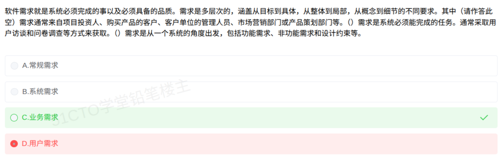

# 备考笔记：业务需求-需求层次来源对号

## 一、题目
> 软件需求就是系统必须完成的事以及必须具备的品质。需求是多层次的，涵盖从目标到具体，从整体到局部，从概念到细节的不同要求。其中**（请作答此空）**需求通常来自项目投资人、购买产品的客户、客户单位的管理人员、市场营销部门或产品策划部门等。（ ）需求是系统必须完成的任务，通常采取用户访谈和问卷调查等方式来获取。（ ）需求是从一个系统的角度出发，包括功能需求、非功能需求和设计约束等。
> A. 常规需求
> B. 系统需求
> C. 业务需求
> D. 用户需求

**答案：C. 业务需求**（本题为三空连环填空，"请作答此空"标在第一空；第二空为用户需求，第三空为系统需求）

## 二、知识点：业务需求-需求层次来源对号

### 1. 核心原理
软件需求分**业务需求 → 用户需求 → 系统需求**三层，每层有专属"指纹"，按来源、获取方式、组成内容即可对号入座：

| 层次 | 专属指纹（关键词） | 本题对应空 |
| --- | --- | --- |
| 业务需求 | **来自**项目投资人、购买产品的客户、客户单位管理人员、市场营销部门、产品策划部门；确定项目视图与范围 | 第一空（请作答此空）✓ |
| 用户需求 | 系统必须完成的**任务**；用**用户访谈、问卷调查**获取；描述用户能用系统做什么 | 第二空 |
| 系统需求 | **从系统角度**出发；含**功能需求、非功能需求、设计约束** | 第三空 |

一句话记忆：**看"来源"选业务，看"任务+访谈问卷"选用户，看"系统角度+功能/非功能/约束"选系统。**

### 2. 关键公式/规则

| 名称 | 内容 |
| --- | --- |
| 三层次顺序 | 业务需求 → 用户需求 → 系统需求（从目标到具体、从整体到局部、从概念到细节） |
| 业务需求指纹 | 来源=投资人/客户/管理层/市场/产品策划；产出=项目视图与范围 |
| 用户需求指纹 | 用户具体目标、必须完成的任务；获取=访谈、问卷、场景（scenarios）整理 |
| 系统需求指纹 | 系统角度 = 功能需求 + 非功能需求 + 设计约束 |
| 干扰项识别 | "常规需求"不是软件需求层次（属 Kano 模型语境的需求分类） |

### 3. 解题步骤
1. **先定位"请作答此空"**：连环填空题先看清此空标记落在第几句，切勿拿后文关键词答前空。
2. **抓该句的专属指纹**：本空句中"来自项目投资人、购买产品的客户、客户单位的管理人员、市场营销部门或产品策划部门"是业务需求的教科书式来源描述。
3. **对号入座**：来源描述 → 业务需求，选 C。同时验证后两空：访谈问卷获取 → 用户需求；系统角度+三组成 → 系统需求，B、D 各归其位。

## 三、易错点
1. **空位错配（本题错因）**：误选 D 用户需求，是被题干后文"用户访谈和问卷调查"的关键词带跑——那是**第二空**的指纹；"请作答此空"在**第一空**，考的是**来源**。
2. **来源 ≠ 获取方式**：业务需求看"**来自谁**"（投资人/客户/管理层/市场/产品策划），用户需求看"**怎么获取**"（访谈/问卷/场景整理），两条指纹不可互换。
3. **常规需求是干扰项**：它不是软件需求的层次；软件需求层次只认业务/用户/系统三层。
4. **系统需求组成缺一不可**：功能需求、非功能需求、设计约束三者是"从系统角度"的标志，常被拆开单独考归属。

## 四、扩展延伸
- 与既有笔记 [111-软件需求层次-业务用户系统三层辨析.md](111-软件需求层次-业务用户系统三层辨析.md) 同源：111 是教程原文梳理，本题是该知识点的**真题化变式**（三空连环+干扰项）。
- 相关笔记：[109-软件需求分析-任务描述与产出规格辨析.md](109-软件需求分析-任务描述与产出规格辨析.md)、[88-需求分析方法-三类清单辨析.md](88-需求分析方法-三类清单辨析.md)。
- 常见变式：①单空只给"投资人/客户/管理层"来源 → 业务需求；②问"哪个不是需求层次" → 数据需求/常规需求；③问"功能需求属于哪一层次的内容" → 系统需求。
- 记忆锚点：业务需求定**"为什么做"**（视图与范围），用户需求定**"用系统做什么"**（任务/场景），系统需求定**"系统做成什么样"**（功能+非功能+约束）。

## 五、错题归档
| 题号 | 题型 | 考点 | 难度 | 掌握度 |
| --- | --- | --- | --- | --- |
| — | 单选 | 需求三层次：按来源/获取方式/组成对号入座（业务需求指纹=来源） | 易 | 薄弱 |

（重做本题时在表尾追加 `重做 N` 行，见「步骤 2.5 重做留痕」）

## 六、相关图片
原题截图：`../images/145-业务需求-需求层次来源对号.png`（由用户上传的原题图复制改名而来）

