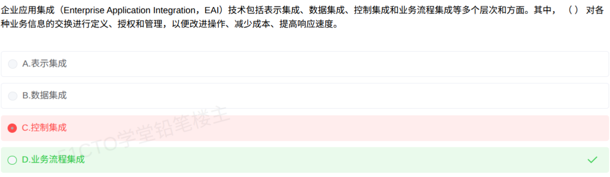

# 备考笔记：EAI集成层次-业务流程集成标签辨析

## 一、题目
> 企业应用集成（Enterprise Application Integration，EAI）技术包括表示集成、数据集成、控制集成和业务流程集成等多个层次和方面。其中（　）对各种业务信息的交换进行定义、授权和管理，以便改进操作、减少成本、提高响应速度。
> A. 表示集成
> B. 数据集成
> C. 控制集成
> D. 业务流程集成

**答案：D. 业务流程集成**

解析：题干"对各种业务信息的交换进行定义、授权和管理，以便改进操作、减少成本、提高响应速度"是教材中**业务流程集成（过程集成）**的定义原句，逐字对应，属标签句对号题。本人误选 C"控制集成"，是被"授权、管理"与"控制"的字面联想带偏；控制集成的教材标签是"为两个应用中的数据或函数提供接近实时的集成"，与题干表述完全不同。

## 二、知识点：EAI集成层次-业务流程集成标签辨析

### 1. 核心原理
EAI 的集成层次存在两种教材表述：四层次版本（表示集成、数据集成、控制集成、业务流程集成）与五层面版本（增加平台集成，见 [105-EAI企业应用集成-五个集成层面.md](105-EAI企业应用集成-五个集成层面.md)）。两种版本的标签句完全一致，考试只认**标签句**对号，不数版本。

各层教材定义标签（四层次版本）：

| 层次 | 别称 | 专属标签句 |
| --- | --- | --- |
| 表示集成 | 界面集成 | 最原始、最浅层次但最常用；把零散界面集中到统一界面（通常是浏览器） |
| 数据集成 | — | 先对数据标识并编成目录、确定元数据模型；保证数据分布和共享 |
| 控制集成 | 应用集成 | 为两个应用中的**数据或函数**提供**接近实时**的集成 |
| 业务流程集成 | 过程集成 | 对各种业务信息的交换进行**定义、授权和管理**，以便**改进操作、减少成本、提高响应速度**；层次最高 |

本题考查的是最后一句：它属于**业务流程集成**，是四层次中最高的一层。

### 2. 关键公式/规则
标签速查（命题点在"谁的定义句"）：

| 题干出现 | 选 |
| --- | --- |
| 定义、授权、管理业务信息交换 + 改进操作、减少成本、提高响应速度 | **业务流程集成（过程集成）** |
| 接近实时的数据或函数集成 | 控制集成（应用集成） |
| 元数据模型、数据标识编目 | 数据集成 |
| 浏览器统一界面、最浅最常用 | 表示集成（界面集成） |

口诀：**"实时调用找控制，定义授权管流程。"**

### 3. 解题步骤
1. 定位考法：题干给定义句，问归属层次，属标签句对号题。
2. 提取关键词："业务信息的交换""定义、授权和管理""改进操作、减少成本、提高响应速度"。
3. 与标签表对号：整句命中业务流程集成的教材定义原句，锁定 D。
4. 用排除法复核 C：控制集成的标签句必有"接近实时""数据或函数"字样，题干没有，排除。

## 三、易错点
1. **字面联想陷阱**："授权、管理"容易联想到"控制"而误选 C。控制集成的"控制"指应用之间通过 API/函数相互调用的控制，不是对业务信息交换流程的管理。判断只认标签句，不认字面相似。
2. **收益短语固定搭配**："改进操作、减少成本、提高响应速度"是业务流程集成定义句的固定收尾，命题可能单独拿这半句设问，同样选业务流程集成。
3. **层次高低混淆**：业务流程集成是 EAI 中层次最高、价值最大的集成，命题可反向考"最高层次是（　）"，勿选成表示集成（最浅）。
4. **版本计数陷阱**：四层次版与五层面版（多"平台集成"）并存，若选项里出现"平台集成"而题干只列四层次，按题干给定的层次范围作答。

## 四、扩展延伸
- 本题标签句出自教材 EAI 一节的原文，五层面完整表述及平台集成的说明见 [105-EAI企业应用集成-五个集成层面.md](105-EAI企业应用集成-五个集成层面.md)。
- 过程集成通常借助工作流引擎落地，与 [76-工作流参考模型-六大基本模块辨析.md](76-工作流参考模型-六大基本模块辨析.md) 呼应。
- EAI 的架构选型（总线 vs 共享库等）另见 [75-异构系统集成-总线架构选型.md](75-异构系统集成-总线架构选型.md)，注意"集成层次"与"集成架构"是两个不同考法。

## 五、错题归档
| 题号 | 题型 | 考点 | 难度 | 掌握度 |
| --- | --- | --- | --- | --- |
| 146 | 单选 | EAI 集成层次标签句：业务流程集成的教材定义 | 易 | 薄弱（误选 C） |

（重做本题时在表尾追加 `重做 N` 行，见「步骤 2.5 重做留痕」）

## 六、相关图片
原题截图：`../images/146-EAI集成层次-业务流程集成标签辨析.png`（由用户上传的原题图复制改名而来）

