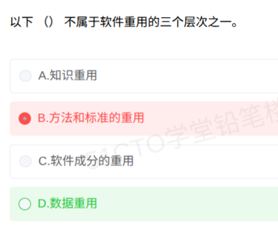

# 备考笔记：软件重用三层次辨析

## 一、题目

> 以下（ ）不属于软件重用的三个层次之一。
>
> A. 知识重用
>
> B. 方法和标准的重用
>
> C. 软件成分的重用
>
> D. 数据重用

**答案：D. 数据重用**

解析：软件重用的三个层次是**固定清单**——**知识重用、方法和标准的重用、软件成分的重用**。A、B、C 三项恰好逐字命中该清单，均"属于"；D"数据重用"不在层次清单中（数据只是"软件成分重用"细分下的一种可复用**成分**，不是层次名称），故"不属于"的选 D。本题易错根因是审题方向反转：题干问的是"**不属于**"，误把"属于"项 B 当成了答案。

## 二、知识点：软件重用三层次辨析

### 1. 核心原理

软件重用（复用）是指在软件开发中重复使用相同或相似软件元素的过程。**按重用对象的抽象程度，软考教材固定划分为三个层次**（由抽象到具体）：

| 层次 | 重用对象 | 举例 |
| --- | --- | --- |
| 1. 知识重用 | 软件工程知识、开发经验、领域知识 | 复用"如何做需求分析"的方法论知识 |
| 2. 方法和标准的重用 | 开发方法、技术标准、规范 | 复用面向对象方法、单位制定的软件工程标准 |
| 3. 软件成分的重用 | 具体的软件制品 | 复用源代码/目标代码、构件、设计、文档、测试用例 |

**要点**：这是**名称级清单**题——"三个层次"的名称是死的，选项必须与清单逐字对号。数据、测试用例等只是第三层"软件成分"内部可细分的**成分**，不是"层次"本身。

### 2. 关键公式/规则

| 名称 | 内容 |
| --- | --- |
| 三层次速记 | **知识 → 方法/标准 → 软件成分**（由虚到实） |
| 软件成分细分 | 项目计划、成本估算、体系结构、需求模型/规格说明、设计、源代码、用户文档和技术文档、用户界面、数据、测试用例 |
| 判定标准 | 选项是否与"三层次"名称逐字一致；细分成分 ≠ 层次名称 |

### 3. 解题步骤

1. **圈出问法方向**：本题问"**不属于**"，要找的是**不在**清单里的选项。
2. **默写固定清单**：知识重用、方法和标准的重用、软件成分的重用。
3. **逐项对号**：A、B、C 逐字命中清单 → 全是"属于"项，排除。
4. **锁定答案**：D"数据重用"不是层次名称 → 选 **D**。

## 三、易错点

1. **审题方向反转（本次错选 B）**：题干问"不属于"，B"方法和标准的重用"恰是三层次之一，是标准的"属于"项。选 B 说明把"不属于"读成了"属于"，或清单没记住只能凭感觉挑。负向问法（不属于/错误的是）务必先圈题再选。
2. **三层次清单记不全**：只记得"软件成分重用"而漏掉"知识重用""方法和标准的重用"，导致排除法失效。用"由虚到实"串联记忆：**知识（最虚）→ 方法标准（中）→ 软件成分（最实）**。
3. **"数据重用"的现实迷惑**：现实中数据确实可复用（数据库共享、数据字典），Pressman 教材也把"数据"列为可复用成分之一。但软考口径下它只是"软件成分"的一个**细分项**，不是"三个层次"的名称，别被"数据也能复用啊"的直觉带偏。
4. **与 87 号"代码重用方式"题混淆**：87 号考"代码重用的实现方式"（函数、对象、类、模块、算法），本题考"重用的三个层次"。同主题不同命题粒度：87 问**怎么复用代码**，本题问**复用分几层、每层叫什么**。

## 四、扩展延伸

- **三层次与细分成分的包含关系**：知识重用 ⊃ 方法和标准的重用 ⊃ 软件成分的重用（抽象度递减）；软件成分重用内部再细分出源代码、设计、数据、测试用例等成分。命题人常用**细分成分冒充层次名称**设陷，反之也可能用层次名称考"细分成分有哪些"。
- **现实类比**：把软件开发比作做菜——**知识重用**是"懂得烹饪原理"，**方法和标准的重用**是"照菜谱和厨房规范做"，**软件成分的重用**是"直接用半成品和预制料"；数据、测试用例只是"预制料"中的一种，不能说"预制料"是一个独立的"做菜层次"。
- **相关笔记**：
  - [87-代码重用方式辨析.md](87-代码重用方式辨析.md)：同主题不同角度，考代码重用的实现单元；
  - [22-构件接口不兼容的常见问题.md](22-构件接口不兼容的常见问题.md)：软件成分重用中"构件"复用的落地问题。

## 五、错题归档

| 题号 | 题型 | 考点 | 难度 | 掌握度 |
| --- | --- | --- | --- | --- |
| 软考-软件工程 | 单选 | 软件重用三层次：知识重用、方法和标准的重用、软件成分的重用；数据重用不在其中 | 易 | 薄弱 |

（重做本题时在表尾追加 `重做 N` 行，见「步骤 2.5 重做留痕」）

## 六、相关图片

原题截图：`../images/147-软件重用三层次辨析.png`（由用户上传的原题图复制改名而来）

