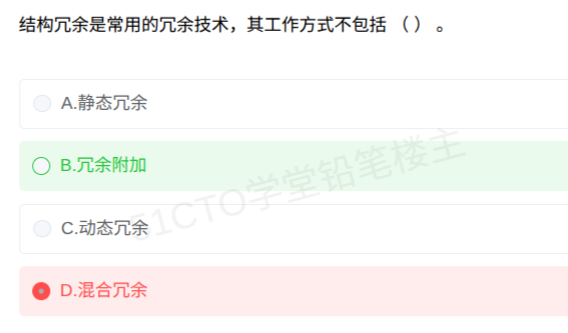

# 备考笔记：结构冗余工作方式辨析

## 一、题目

> 结构冗余是常用的冗余技术，其工作方式不包括（ ）。
>
> A. 静态冗余
> B. 冗余附加
> C. 动态冗余
> D. 混合冗余

**答案：B. 冗余附加**

解析：结构冗余（硬件冗余）按其**工作方式**只分三种：**静态冗余、动态冗余、混合冗余**。**冗余附加**是与之**并列**的第四类冗余技术，指为实现容错所必需的**支撑性技术**（表决器、切换开关、监控定时器等），不是结构冗余之下的一种工作方式。本次误选 D（混合冗余），混合冗余恰恰是结构冗余三种工作方式之一，属于"包括"的合法项；四个选项里只有 B 不在结构冗余的工作方式之列。

## 二、知识点：结构冗余工作方式辨析

### 1. 核心原理

冗余技术有**两个分类层次**，命题人正是利用这两个层次做文章：

- **第一层（按冗余资源性质分四类）**：**结构冗余、信息冗余、时间冗余、冗余附加**，四者是并列关系。
- **第二层（只有结构冗余再按工作方式分三类）**：**静态冗余、动态冗余、混合冗余**。

结构冗余的三种工作方式：

- **静态冗余**：冗余模块**同时在线、同时工作**，输出送**表决器**取多数结果，故障当场被掩盖，**无需切换**。典型：**三模冗余（TMR）、多模冗余**。
- **动态冗余**：平时只有一套部件工作，**备用件待命**，检测到故障后**切换/重组**让备件顶上。典型：**热备系统、冷备系统**。
- **混合冗余**：**静态 + 动态**结合，先用表决器掩盖故障，再动态替换失效模块。

**冗余附加**的内容：为实现上述冗余技术所需的**配套支撑**，如**冗余备份程序的存储及调用、错误检测与错误恢复程序、表决器/比较器/切换开关、监控定时器（看门狗）**等。它与结构冗余是"兄弟"不是"父子"。

### 2. 关键公式/规则

| 分类归属 | 工作机制 | 典型例子 | 是否属于"结构冗余的工作方式" |
| --- | --- | --- | --- |
| 结构冗余-静态 | 同时在线，表决取多数，故障被掩盖、不切换 | 三模冗余 TMR、多模冗余 | ✓ 是 |
| 结构冗余-动态 | 备件待命，故障后切换 | 热备系统、冷备系统 | ✓ 是 |
| 结构冗余-混合 | 先表决掩盖，后动态替换 | 表决器 + 备用模块 | ✓ 是 |
| 冗余附加（第一层并列大类） | 提供支撑性配套技术 | 表决器、切换开关、看门狗 | ✗ **不是** |

- **判据口诀**："**四类冗余并列，结构独分三家（静、动、混），附加只当支撑**"。
- **静动之别**：静态 = "同时在线靠表决"，动态 = "备而不用才切换"。
- **归属速查**：看到"校验码"想信息冗余，看到"复执/卷回"想时间冗余，看到"表决器/看门狗"想冗余附加。

### 3. 解题步骤

1. **审题抓否定词**：题干问"工作方式**不包括**"，属于否定式提问，要找的是**不属于**结构冗余工作方式的那个选项。
2. **回忆分类层次**：结构冗余按工作方式三分 = 静态、动态、混合；冗余附加是第一层并列大类。
3. **逐项比对**：A 静态冗余 ✓ 属于；C 动态冗余 ✓ 属于；D 混合冗余 ✓ 属于；B 冗余附加 ✗ 不属于（并列大类）。
4. **确定答案**：只有 B "不包括"，选 **B**。

## 三、易错点

1. **否定式提问漏看"不"字**：正向问"包括"与反向问"不包括"的答案恰好互补，审题时先圈出"不包括"再作答。
2. **两个分类层次混淆**（命题人埋伏点）：把"冗余附加"错当成结构冗余的一种工作方式。记住第二层分类**只有结构冗余独享**，信息、时间、附加都不再细分。
3. **本次误选 D（混合冗余）**：混合冗余是结构冗余三种工作方式之一，是题干"包括"的合法项；误选它等于把"合法项"当成了"非法项"，方向正好相反。
4. **冗余附加内容想不起来**：其附加的是"支撑技术"，典型词有表决器、比较器、切换开关、监控定时器（看门狗）、错误检测与恢复程序；看到这些词应先定位到第一层的"冗余附加"。
5. **同主题两个命题方向**：64 号笔记考"第一层归类"（热备冷备 → 结构冗余-动态），本题考"第二层三分的边界"（冗余附加不是结构冗余的工作方式），同一知识点的两个方向都要过关。

## 四、扩展延伸

- **教材表述**：结构冗余是最常用的冗余技术，按其工作方式可分为静态冗余、动态冗余和混合冗余；此句是本题的直接出处，"按其工作方式"四个字圈定了三分法的适用范围。
- **故障屏蔽 vs 故障恢复**：静态冗余靠表决实现**故障屏蔽**（用户无感）；动态冗余先检测故障再切换，实现**故障恢复**；混合冗余两者兼有。
- **四类冗余一句话记忆**：结构冗余"多配硬件"，信息冗余"多加校验"，时间冗余"重做一遍"，冗余附加"配套支撑"。
- **关联笔记**：[64-容错计算-冗余技术分类与结构冗余.md](64-容错计算-冗余技术分类与结构冗余.md) 讲第一层归类（热备/冷备归属结构冗余-动态），[06-系统可靠性-串并联冗余模型.md](06-系统可靠性-串并联冗余模型.md) 讲这类硬件冗余的可靠度定量计算，三篇连读形成"归类 → 工作方式 → 计算"的完整链条。

## 五、错题归档

| 题号 | 题型 | 考点 | 难度 | 掌握度 |
| --- | --- | --- | --- | --- |
| 计算机系统（容错计算） | 单选 | 结构冗余三分工作方式（静/动/混）与冗余附加的并列边界 | 易 | 薄弱（本次误选 D 混合冗余） |

（重做本题时在表尾追加 `重做 N` 行，见「步骤 2.5 重做留痕」）

## 六、相关图片

原题截图：`../images/148-结构冗余工作方式辨析.png`（由用户上传的原题图复制改名而来）

