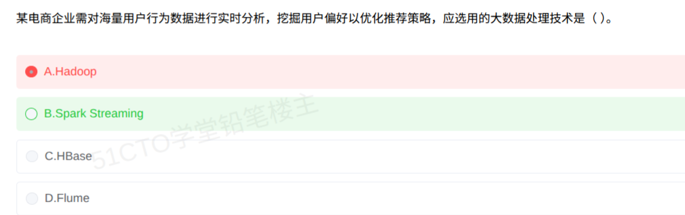

# 备考笔记：大数据-实时分析技术选型

## 一、题目

> 某电商企业需对海量用户行为数据进行实时分析，挖掘用户偏好以优化推荐策略，应选用的大数据处理技术是（  ）。
>
> A. Hadoop
>
> B. Spark Streaming
>
> C. CBase
>
> D. Flume

**答案：B. Spark Streaming**

解析：题干两个关键词——"**海量**"与"**实时分析**"。"实时"决定了必须选**流计算引擎**：Spark Streaming 把数据流切成小批次（微批）持续计算，可秒级产出偏好分析结果，符合实时推荐场景。A 项 Hadoop（HDFS + MapReduce）是**离线批处理**代表，延迟分钟/小时级；C 项 CBase（HBase 一类的列式 NoSQL）是**存储组件**，只负责海量数据随机读写，本身不做分析计算；D 项 Flume 是**日志采集/传输**工具，只解决"数据怎么进来"，不承担"怎么算"。

## 二、知识点：大数据-实时分析技术选型

### 1. 核心原理

大数据题目本质是**按"数据在流水线中的角色"对号入座**，而不是比谁名气大。一条完整链路由四段构成：

| 环节 | 职责 | 代表技术 |
| --- | --- | --- |
| 采集/传输 | 把数据搬进来 | Flume、Sqoop、Kafka |
| 存储 | 把数据存下来 | HDFS、HBase/CBase、ClickHouse |
| 计算 | 把数据算出来 | 离线：MapReduce、Spark 批处理；实时：Spark Streaming、Flink、Storm |
| 查询/分析 | 把结果用起来 | Hive、Impala、ClickHouse、Doris |

题干若落在"**实时** + **分析/挖掘/推荐/监控**"，答案必然落在**计算环节的流式引擎**上。

| 技术 | 定位 | 时效性 | 典型用途 |
| --- | --- | --- | --- |
| Hadoop（MapReduce） | 离线批处理 | 分钟/小时级 | T+1 报表、批量 ETL |
| Spark Streaming | 流计算（微批） | 秒级（准实时） | 实时推荐、实时指标 |
| CBase / HBase | 列式 NoSQL 存储 | 毫秒级随机读写 | 海量明细存储、实时查询底座 |
| Flume | 日志采集与传输 | 实时搬运，不计算 | 日志汇聚入 HDFS/Kafka |

**关键结论**：

- **"实时分析"选 Spark Streaming / Flink**，绝不选 Hadoop。
- **存储类（CBase/HBase）与采集类（Flume）永远不是"分析技术"**，这是本题两大干扰项。
- Spark Streaming 采用**微批（micro-batch）**，延迟秒级，考试口径中归入实时处理。

### 2. 关键公式/规则

| 名称 | 判据/对照 |
| --- | --- |
| 实时判据 | 数据流式到达 + 低延迟（秒/毫秒级）+ 边到边算 |
| 离线判据 | 数据已落库 + 批量 + 高吞吐 + 高延迟 |
| 角色判据 | 采集（Flume/Kafka）、存储（HDFS/HBase）、计算（Spark/Flink）、查询（Hive/ClickHouse） |
| 场景关键词 | "实时推荐/实时风控/实时监控/行为分析" → 流计算 |
| 干扰项排除 | 只存不算（HBase/CBase）、只搬不算（Flume/Sqoop） |

速记口诀：**"搬数据找 Flume，存数据找 HBase，离线算找 Hadoop，实时算找 Spark Streaming/Flink。"**

### 3. 解题步骤

1. **抓时效**：题干出现"实时分析"，直接排除离线批处理 → **A. Hadoop 出局**。
2. **抓角色**：要的是"分析"，即计算能力 → 审视剩余项是否具备计算引擎。
3. **排存储**：CBase/HBase 是列式 NoSQL **存储**，提供毫秒级读写，但不做流式分析 → **C 出局**。
4. **排采集**：Flume 只负责日志**采集与传输**，是数据管道，不具备计算能力 → **D 出局**。
5. **定答案**：Spark Streaming 是流计算引擎，微批处理、秒级延迟，契合"实时挖掘偏好优化推荐" → **选 B**。

## 三、易错点

1. **见"海量"就选 Hadoop**：海量只是数据规模，**时效性才决定技术路线**。题干写了"实时"，Hadoop 再能扛量也不对。
2. **把存储当计算**：HBase/CBase 是数据库，能"查"不能"算"，选它等于把仓库当工厂。
3. **把采集当分析**：Flume 只搬数据，不做任何计算；Kafka 同理，是管道不是引擎。
4. **误以为实时只能是 Flink**：Spark Streaming 是**微批准实时**（秒级），软考口径中同样算实时技术，不要因为"不是真流"就排除。
5. **忽略"推荐策略"这一场景信号**：实时推荐是 Spark Streaming / Flink 的经典落地场景，出现即指向流计算。

## 四、扩展延伸

- **Spark Streaming vs Flink**：前者微批（把流切成小 RDD 批），延迟秒级、生态与 Spark 批处理打通；后者逐事件真流式，延迟毫秒级、状态管理与乱序处理更强。考试常把二者同归"实时"。
- **CBase 是什么**：可视为 HBase 一族的列式 NoSQL 数据库（华为 FusionInsight 体系中即有 CBase），面向海量稀疏数据的高并发随机读写，常作实时查询的存储底座。
- **典型电商实时链路**：用户行为日志 → Flume/Kafka 采集 → Spark Streaming 实时计算偏好向量 → 写入 HBase/CBase → 推荐服务毫秒级读取，形成闭环。
- **现实类比**：Flume 是**传送带**，HBase 是**货架**，Hadoop 是**月底盘库**，Spark Streaming 是**收银台实时记账**——本题问"实时分析"，只能选收银台。

## 五、错题归档

| 题号 | 题型 | 考点 | 难度 | 掌握度 |
| --- | --- | --- | --- | --- |
| 系统分析师-新技术-大数据 | 单选 | 实时分析技术选型（Spark Streaming 与 Hadoop/CBase/Flume 的角色辨析） | 易 | 待复习 |

## 六、相关图片

原题截图：`../images/149-大数据-实时分析技术选型.png`（由用户上传的原题图复制改名而来）

