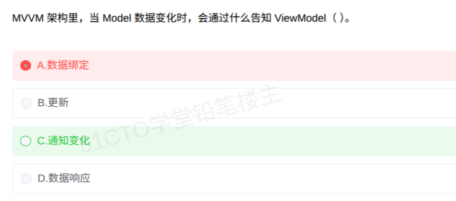

# 备考笔记：MVVM-Model变化通知机制辨析

## 一、题目

> MVVM 架构里，当 Model 数据变化时，会通过什么告知 ViewModel（ ）。
>
> A. 数据绑定
>
> B. 更新
>
> C. 通知变化
>
> D. 数据响应

**答案：C. 通知变化**

解析：先看方向。题干问的是 **Model（变化源）→ ViewModel（接收方）** 这一条边靠什么通信。MVVM 中组件间交互机制是**分边的**：View 与 ViewModel 之间靠**数据绑定**实现双向自动同步；而 Model 数据变化告知 ViewModel，靠的是**通知机制**（本质是观察者模式/发布订阅），ViewModel 订阅 Model 的变化事件，收到通知后再经数据绑定刷新 View。A 项「数据绑定」是 MVVM 的标志性标签词，但它描述的是 View 与 ViewModel 之间的同步关系，管不到 Model 这条边；B 项「更新」是变化产生的结果，不是通信机制；D 项「数据响应」不是 MVVM 的标准术语（那是 Vue 等框架实现层面的说法）。

## 二、知识点：MVVM-Model变化通知机制辨析

### 1. 核心原理

MVVM（Model-View-ViewModel）三组件的交互机制**按方向分工**，不能一概而论：

| 交互方向 | 机制 | 说明 |
| --- | --- | --- |
| View ↔ ViewModel | **数据绑定**（双向） | 状态与 UI 自动同步，绑定关系建立后无需手动操作 DOM/控件 |
| Model → ViewModel | **通知变化**（观察者模式/发布订阅） | Model 作为被观察者发出变化通知，ViewModel 作为观察者订阅响应 |
| ViewModel → Model | 直接读写 | ViewModel 封装业务逻辑，操作 Model 获取/更新数据 |

数据流转全链路：**Model 变化 → 发出通知 → ViewModel 收到通知并更新自身状态 → 经数据绑定驱动 View 刷新**。

因此「Model 如何告知 ViewModel」的答案是**通知**，不是绑定。绑定的作用域自始至终只覆盖 View 与 ViewModel 这一对。

### 2. 关键公式/规则

| 名称 | 判据/对照 |
| --- | --- |
| 方向判据 | 问 View↔ViewModel 同步 → 数据绑定；问 Model→ViewModel 告知 → 通知（观察者） |
| 标签词陷阱 | 「数据绑定」是 MVVM 的高频标签，但只描述 View 与 ViewModel 之间的同步关系 |
| 机制本质 | 通知的实现 = 观察者模式（Observer）或发布订阅（Pub/Sub） |
| 干扰项排除 | 「更新」是结果不是机制；「数据响应」非标准术语 |

速记口诀：**「绑定连视图，通知告模型」**。View 与 ViewModel 之间靠绑定，Model 变化靠通知。

### 3. 解题步骤

1. **定方向**：抓题干主体与受体，Model（变化源）→ ViewModel（接收方），锁定「Model→ViewModel」这一条边。
2. **排标签词**：「数据绑定」虽是 MVVM 的招牌，但它的管辖范围是 View↔ViewModel，覆盖不到 Model → **A 出局**。
3. **排结果词**：「更新」是通知到达后产生的动作结果，不是通信机制本身 → **B 出局**。
4. **排杜撰词**：「数据响应」不是 MVVM 模式的标准概念 → **D 出局**。
5. **定答案**：Model 变化通过**通知**（观察者/发布订阅机制）告知 ViewModel → **选 C**。

## 三、易错点

1. **见 MVVM 就选「数据绑定」**：这是命题者埋的标签词陷阱。绑定是 MVVM 的标志性特征没错，但它只负责 View↔ViewModel 的同步；题干问的是 Model→ViewModel 这条边，靠的是通知。看到「数据绑定」先别抢答，先核对题干问的是哪条边。
2. **把「更新」当机制**：更新是通知被接收后发生的结果描述，不是机制名称。机制回答「靠什么通信」，结果回答「发生了什么」。
3. **被「数据响应」迷惑**：响应式（Reactive）是 Vue 等框架实现 MVVM 时的底层手段，属于实现细节而非 MVVM 模式定义中的通信术语，出题口径中不选。
4. **忽略方向性**：MVVM 考题常见变式是把方向反过来问「View 与 ViewModel 之间靠什么同步」，那时的答案才是数据绑定。做这类题先画箭头再选答案。

## 四、扩展延伸

- **MVC / MVP / MVVM 三兄弟对比**：
  - **MVC**：Model-View-Controller，Controller 接收输入并调度 Model 与 View，View 可直接读 Model，同步靠手动。
  - **MVP**：Model-View-Presenter，Presenter 完全隔离 Model 与 View（二者互不引用），通过接口手动同步，逻辑清晰但代码量大。
  - **MVVM**：Model-View-ViewModel，ViewModel 是 View 的抽象，靠**数据绑定 + 通知**实现自动同步，开发者从手动同步中解放。
- **通知机制的实现**：本质是观察者模式。ViewModel 向 Model（或其变化事件源）注册观察，Model 一变即发布通知。发布订阅模式是其解耦更强的变体。
- **典型落地**：WPF/Silverlight 最早由 John Gossman 提出 MVVM（2005 年）；前端领域 Vue.js、Knockout、Angular 均借鉴该模式，Vue 的 `ref/reactive` 响应式系统就是「Model 变化 → 发通知 → 视图更新」的工程实现。
- **现实类比**：Model 是**仓库**，ViewModel 是**中间商**，View 是**店面货架**。仓库进货（Model 变化）会**打电话通知**中间商（通知变化），中间商再按**价签联动规则**（数据绑定）刷新货架。货架与中间商之间的联动规则再好，也代替不了那通电话。

## 五、错题归档

| 题号 | 题型 | 考点 | 难度 | 掌握度 |
| --- | --- | --- | --- | --- |
| 系统分析师-新技术-MVVM | 单选 | MVVM 三组件交互机制辨析（Model→ViewModel 靠通知而非数据绑定） | 易 | 薄弱 |

（重做本题时在表尾追加 `重做 N` 行，见「步骤 2.5 重做留痕」）

## 六、相关图片

原题截图：`../images/150-MVVM-Model变化通知机制辨析.png`（由用户上传的原题图复制改名而来）

