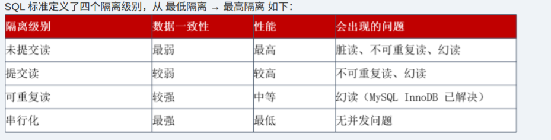

# 备考笔记：SQL 隔离级别-四级对比

## 一、题目

> 本篇为用户提供的知识点汇总卡，无题干与选项。原卡内容：SQL 标准定义了四个隔离级别，从最低隔离到最高隔离依次为未提交读、提交读、可重复读、串行化。
>
> | 隔离级别 | 数据一致性 | 性能 | 会出现的问题 |
> | --- | --- | --- | --- |
> | 未提交读 | 最弱 | 最高 | 脏读、不可重复读、幻读 |
> | 提交读 | 较弱 | 较高 | 不可重复读、幻读 |
> | 可重复读 | 较强 | 中等 | 幻读（MySQL InnoDB 已解决） |
> | 串行化 | 最强 | 最低 | 无并发问题 |

**答案：知识点汇总卡，无标准答案。**

## 二、知识点：SQL 隔离级别-四级对比

### 1. 核心原理

隔离级别定义的是**并发事务之间的可见性边界**：一个事务能看到其他事务做到哪一步的数据。级别越高，可见范围越窄，一致性越强，并发代价越大。

三个读现象，按"被干扰的对象"区分：

- **脏读（Dirty Read）**：读到了其他事务**尚未提交**的数据。对方一旦回滚，读到的数据从未存在过。
- **不可重复读（Non-repeatable Read）**：同一事务内两次读**同一行**，值变了。成因是其他事务对该行做了 **UPDATE 并提交**。
- **幻读（Phantom Read）**：同一事务内两次按**同一条件**查询，**结果集的行数**变了。成因是其他事务 **INSERT 或 DELETE 并提交**。

四个级别是**逐级封堵**的关系：每一级在上一级基础上再封死一个现象。

- 未提交读：什么都不封，三种现象全可能出现。
- 提交读：只封脏读，因为它只允许看到已提交数据。
- 可重复读：再封不可重复读，事务内使用一致性快照，同一行两次读到的值不变。
- 串行化：再封幻读，对查询范围加锁或强制串行执行。

注意：**"可重复读能解决幻读"是 MySQL InnoDB 的实现特性，不是 SQL 标准的规定**。标准中可重复读仍允许幻读，InnoDB 用间隙锁（Next-Key Lock）在快照读之外补上了这道口子。

### 2. 关键公式/规则

四级别与三种现象的封堵矩阵（"可能"表示该级别下仍会出现）：

| 隔离级别 | 脏读 | 不可重复读 | 幻读 | 一致性 | 性能 |
| --- | --- | --- | --- | --- | --- |
| 未提交读 Read Uncommitted | 可能 | 可能 | 可能 | 最弱 | 最高 |
| 提交读 Read Committed | 不可能 | 可能 | 可能 | 较弱 | 较高 |
| 可重复读 Repeatable Read | 不可能 | 不可能 | 可能（InnoDB 基本避免） | 较强 | 中等 |
| 串行化 Serializable | 不可能 | 不可能 | 不可能 | 最强 | 最低 |

典型实现手段：

| 级别 | 主要手段 |
| --- | --- |
| 未提交读 | 不加读锁，直接读最新版本 |
| 提交读 | 每条语句取一次最新已提交快照（语句级快照） |
| 可重复读 | 事务开始时建立一致性快照（事务级快照）+ 必要的行锁 |
| 串行化 | 范围锁 / 间隙锁，或串行执行事务 |

常见 DBMS 默认级别：

| DBMS | 默认隔离级别 |
| --- | --- |
| MySQL（InnoDB） | 可重复读 |
| Oracle | 提交读 |
| SQL Server | 提交读 |
| PostgreSQL | 提交读 |

### 3. 解题步骤

1. **先定位级别**：题干给出的级别是哪一档，或问"某级别还会出现什么问题"。
2. **沿封堵链条推断**：未提交读三问全有；提交读去掉脏读；可重复读再去掉不可重复读；串行化全无。只可能"向下兼容"，不会出现"高级别反而多一种问题"。
3. **按操作类型判断现象**：对方是 **UPDATE** 同一行 → 不可重复读；对方是 **INSERT/DELETE** 导致行数变化 → 幻读；对方**尚未提交** → 脏读。
4. **看限定词**：题干说"SQL 标准"就按标准答（可重复读仍可能幻读）；说"MySQL InnoDB"才答"已解决幻读"。
5. **一致性/性能方向题**：两者反向。级别升高，一致性增强、并发性能下降。

## 三、易错点

1. **不可重复读与幻读的对象不同**：前者是**同一行内容变了**（UPDATE），后者是**结果集行数变了**（INSERT/DELETE）。只记"读两次不一样"会在二者之间摇摆，必须落到"行内容"还是"行数"。
2. **一致性越强，性能越低**：这两个维度是反向关系，题目常把"一致性最高"和"性能最高"配到同一选项上设陷阱。
3. **"可重复读防幻读"有前提**：这是 MySQL InnoDB 的实现结论，不是 SQL 标准的结论。题干强调"SQL 标准"时，可重复读仍列为可能出现幻读。
4. **脏读只与"未提交"有关**：对方最终提交与否不改变判定，只要读取发生在提交之前就是脏读。
5. **提交读不等于"足够可靠"**：它只封了脏读，不可重复读与幻读依然存在，别被"提交"二字误导为高一致性。
6. **串行化不是"只是慢一点"**：它靠范围锁或串行执行换取最强一致性，冲突场景下会大量阻塞，甚至放大死锁概率，是并发能力最弱的一档。

## 四、扩展延伸

- **快照读与当前读**：InnoDB 中普通 SELECT 走 MVCC 快照读，不加锁；`SELECT ... FOR UPDATE`、`UPDATE`、`DELETE` 走当前读，读最新版本并加锁。幻读的"解决"主要体现在快照读场景。
- **间隙锁与 Next-Key Lock**：可重复读下对索引范围加锁，阻止其他事务在区间内插入，从而抑制幻读。
- **隔离级别与死锁**：级别越高，锁范围越大、持有越久，死锁概率上升；这也是很多互联网业务把默认级别下调到提交读的原因。
- **长事务的代价**：可重复读的一致性快照会延长 undo 日志保留时间，长事务容易造成版本链膨胀。
- **记忆口诀**：脏读看"未提交"，重复读看"行变了"，幻读看"行数变了"；四级 RU → RC → RR → Serializable，逐级封堵，性能递减。

## 五、错题归档

| 题号 | 题型 | 考点 | 难度 | 掌握度 |
| --- | --- | --- | --- | --- |
| 知识点卡 | 汇总表 | SQL 四隔离级别与脏读/不可重复读/幻读的对应关系 | 易 | 待复习 |

## 六、相关图片

原卡截图：`../images/151-SQL隔离级别-四级对比.png`（由用户上传的汇总表图片复制改名而来）

