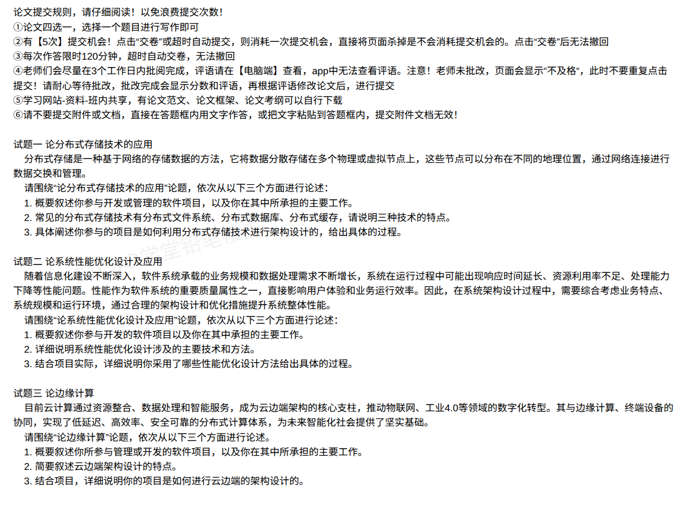

# 备考笔记：边缘计算与云边端架构（论文写作要点）

## 一、题目

> **试题三 论边缘计算**
>
> 目前云计算通过资源整合、数据处理和智能服务，成为云边端架构的核心支柱，推动物联网、工业4.0等领域的数字化转型。其与边缘计算、终端设备的协同，实现了低延迟、高效率、安全可靠的分布式计算体系，为未来智能化社会提供了坚实基础。
>
> 请围绕"论边缘计算"论题，依次从以下三个方面进行论述。
>
> 1. 概要叙述你参与管理或开发的软件项目，以及你在其中所承担的主要工作。
> 2. 简要叙述云边端架构设计的特点。
> 3. 结合项目，详细说明你的项目是如何进行云边端的架构设计的。

**答案：论文题（无标准选项）——按"项目背景 → 云边端架构特点 → 项目云边端设计过程"三段作答。核心采分点：①项目与本人职责；②云、边、端三层分工及低时延、省带宽、本地自治、数据安全、异构接入、云边协同等特点；③本项目"指标分析—分层定责—节点选址—网络协议—数据协同—部署运维—安全可靠"的设计过程。**

解析：第 2 问要"成组"回答特点，不能只说低时延；第 3 问要写清"**哪些能力放云、哪些放边、哪些放端，依据是什么**"，再落到数据流、部署运维与断网自治，才能体现架构设计能力。

## 二、知识点：边缘计算与云边端架构

### 1. 核心原理

**边缘计算**：在靠近数据源或用户侧的网络"边缘"部署计算、存储与网络能力，就近完成数据采集、预处理、实时分析与智能决策，再将需要全局汇聚的数据上传云端。它**不是替代云计算**，而是云计算的**延伸与协同**。

**为什么需要边缘计算**（五个驱动力）：

| 驱动力 | 说明 |
| --- | --- |
| **低时延** | 工业控制、自动驾驶等要求毫秒级闭环，数据往返云端时延不可接受 |
| **大带宽与海量数据** | 高清视频、振动/图像采样数据量巨大，全量回传成本高、带宽吃不消 |
| **本地自治** | 网络中断或云端故障时，生产现场必须继续运行 |
| **数据安全与合规** | 敏感数据"不出厂区/不出园区"，减少暴露面 |
| **海量异构设备接入** | 设备协议多样（Modbus、OPC UA、MQTT），需在边缘做协议适配与统一接入 |

**云边端三层分工**（架构的骨架）：

| 层次 | 位置 | 算力与存储 | 核心职责 | 典型技术 |
| --- | --- | --- | --- | --- |
| **云端（中心云）** | 区域/总部数据中心 | 强算力、大容量、弹性 | 全局调度、海量数据汇聚与分析、模型训练、长期存储、统一运维与治理 | 公有云/私有云、数据湖、Kubernetes、AI 训练平台 |
| **边缘（边缘节点/MEC/网关）** | 园区、厂区、基站侧、门店 | 中等算力、有限存储、资源受限 | 实时计算与控制、协议转换、数据清洗/过滤/聚合、本地 AI 推理、断网自治、缓存与消息代理 | 边缘网关、K3s/KubeEdge、Docker、TensorRT/ONNX、MQTT Broker |
| **端侧（终端设备）** | 设备本体 | 弱算力、低功耗 | 数据采集、指令执行、轻量推理、边缘联动 | PLC、传感器、摄像头、AGV、智能终端 |

> 一句话抓手：**云做"全局与长期"，边做"实时与本地"，端做"采集与执行"**。

### 2. 关键规则：云边端架构设计的特点

第 2 问按以下六条成组作答（每条一句定义 + 一句项目落点）：

| 特点 | 内涵 | 设计落点 |
| --- | --- | --- |
| **① 低时延** | 计算下沉到数据源附近，减少网络往返，满足毫秒级闭环 | 实时控制与告警在边缘完成，不上云 |
| **② 省带宽** | 边缘先清洗、聚合、抽帧，只回传有价值的数据 | 视频抽帧/结构化后上传，回传量下降一个量级 |
| **③ 本地自治与高可靠** | 断网时边缘可独立运行，网络恢复后补传 | 边缘本地缓存 + 断点续传 + 本地规则引擎 |
| **④ 数据安全与隐私** | 敏感数据本地处理、脱敏后上传，减少暴露面 | 数据分级、边缘脱敏、传输加密、设备认证 |
| **⑤ 异构接入与协议适配** | 屏蔽设备差异，统一数据模型与接入协议 | 边缘网关做 Modbus/OPC UA → MQTT 转换 |
| **⑥ 云边协同与统一运维** | 云负责训练与全局调度，边负责推理与执行；模型、配置、镜像统一下发 | 模型云端训练、边缘推理、灰度下发与版本回滚 |

**补充特点**（可作为加分项）：**资源受限与轻量化**（边缘用 K3s、容器、边缘函数而非全量 K8s）、**层次化/分布式部署**（多级边缘：现场级 → 园区级 → 区域级）、**弹性与可扩展**（边缘节点批量纳管）。

**与相近概念的区分**（易被追问）：

| 概念 | 区分口径 |
| --- | --- |
| **边缘计算 vs 云计算** | 云计算集中、弹性、强算力；边缘计算就近、低时延、本地自治；二者协同而非替代 |
| **边缘计算 vs CDN** | CDN 主要做**内容缓存与分发**（只读加速）；边缘计算可**执行任意计算与逻辑**，能写、能推理、能控制 |
| **边缘计算 vs 雾计算** | 雾计算是更早的分层计算概念，层次更泛；边缘计算强调靠近数据源的网络边缘，是工程化落地形态 |
| **MEC vs 边缘网关** | MEC 是运营商/5G 侧的边缘计算平台；边缘网关是现场侧的协议转换与接入设备，二者常组合使用 |

**关键技术清单**（第 3 问选型时可引用）：

- **接入与协议**：MQTT、OPC UA、Modbus、CoAP、HTTP/2；边缘网关做协议转换与设备影子。
- **边缘运行环境**：Docker + K3s/KubeEdge，镜像增量下发，支持离线运行与远程升级（OTA）。
- **边缘智能**：模型轻量化（剪枝、量化）、推理引擎（TensorRT、ONNX Runtime）、模型云端训练 + 边缘下发、联邦学习（数据不出域）。
- **云边协同**：消息上行（MQTT/Kafka）、指令下行、模型与配置分发、边缘应用市场。
- **网络**：5G/专网、TSN（时间敏感网络）、VPN/专线。
- **安全**：设备证书与双向认证、零信任接入、传输 TLS、数据分级脱敏、OTA 包签名校验。

### 3. 解题步骤（论文作答框架）

#### 第 1 问：项目背景与本人工作（约 300 字）

按"背景 → 痛点 → 规模 → 职责 → 结构预告"写。边缘计算类项目建议选**工业互联网、智慧园区、车路协同、能源/电力、连锁门店**等天然分布式场景；规模带数字（边缘节点数、接入设备数、日均数据量、时延要求）。

#### 第 2 问：云边端架构特点（约 600~800 字）

先给三层分工，再给六条特点，每条配一句"因此在本项目中……"的落点，避免纯理论堆砌。

#### 第 3 问：本项目的云边端架构设计（约 1200~1500 字）

按七步成段，每步写"依据—决策—落地"：

| 步骤 | 设计动作 | 论文可写的具体内容 |
| --- | --- | --- |
| **① 业务与指标分析** | 明确时延、带宽、可用性、合规、成本约束 | 产线控制闭环 ≤ 50ms；视频回传带宽压降 80%；断网需维持 4 小时生产 |
| **② 分层职责划分** | 按"实时性/数据量/隐私/算力"四把尺子决定放端、放边还是放云 | 急停与联动放端/边；质量检测推理放边；模型训练、全局排产、报表放云 |
| **③ 边缘节点选址与规格** | 按设备密度、网络时延、机房条件布点 | 每条产线部署 1 台边缘服务器，园区设汇聚节点；按容器数/推理算力选型 |
| **④ 网络与协议设计** | 现场总线 → 边缘网关 → 园区网 → 云专线 | Modbus/OPC UA 经网关转 MQTT；关键控制走本地专网，管理数据走 5G/专线 |
| **⑤ 数据流与云边协同** | 设计"采集—清洗—本地推理—按需上传—云端训练—模型下发"闭环 | 边缘只上传特征与异常片段；云端训练新模型，灰度下发到边缘并支持回滚 |
| **⑥ 部署与运维** | 容器化、批量纳管、远程升级、可观测 | K3s + KubeEdge 纳管边缘节点；OTA 灰度升级；边缘指标统一接入云监控 |
| **⑦ 安全与可靠性** | 设备认证、传输加密、数据分级、断网自治、备份 | 双向证书认证；敏感数据本地脱敏；断网本地缓存并在恢复后补传；关键节点双机冗余 |

#### 收尾

量化效果（时延、带宽、可用性、人工成本、良率提升）+ 不足与改进（如"边缘节点异构导致镜像体积偏大，后续引入分层镜像与增量升级""联邦学习尚处试点"）。

## 三、易错点

1. **把边缘计算写成"云计算的部署方式"**：边缘计算的核心是**云边端协同与分层定责**，不是把云服务器搬到机房。
2. **把边缘计算等同于 CDN**：CDN 只做内容缓存分发，边缘计算强调**可就地执行计算、推理与控制**。
3. **第 2 问只写低时延**：特点必须成组——省带宽、本地自治、数据安全、异构接入、云边协同缺一不可。
4. **三层职责划分错位**：把 AI 模型训练放边缘、把毫秒级控制放云端，架构直接不成立；划分要给出判据。
5. **忽略边缘资源受限**：直接照搬中心云全量 Kubernetes、模型不做量化剪枝，缺乏工程可行性。
6. **忽略断网自治与运维**：边缘节点数量多、无人值守，必须写本地缓存、断点续传、远程升级、批量纳管。
7. **只讲技术栈不讲设计过程**：第 3 问要的是"如何设计"，必须有指标、取舍、数据流与部署方案。
8. **安全只写"加密"**：边缘设备暴露面大，应包含设备认证、零信任、数据分级脱敏、OTA 签名校验。
9. **项目与场景不匹配**：纯线上 Web 系统硬套"云边端"，缺乏终端与现场网络，属虚构。
10. **云边数据一致性问题被忽略**：边缘离线产生的数据在恢复后如何补传、去重、定序，是设计深度的体现。

## 四、扩展延伸

- **云边端协同的三种典型模式**：① 边缘推理 + 云端训练（最常见）；② 云端全局调度 + 边缘本地执行（排产、调度）；③ 联邦学习（数据不出域，仅上传模型参数）。
- **边缘智能的轻量化手段**：模型剪枝、量化（FP32→INT8）、知识蒸馏、算子融合、专用推理引擎；必要时用 NPU/GPU 加速。
- **5G MEC**：把算力下沉到基站侧，时延可到 10ms 级，适用于车联网、工业视觉、AR/VR。
- **TSN（时间敏感网络）**：为工业实时控制提供确定性时延与抖动保障，常与边缘计算配合。
- **数字孪生**：边缘采集实时数据、云端构建孪生模型并仿真优化，是云边端协同的典型高级形态。
- **与其它笔记联动**：[33-信息物理系统CPS与物联网辨析.md](33-信息物理系统CPS与物联网辨析.md)、[137-分布式系统-关键特征辨析.md](137-分布式系统-关键特征辨析.md)、[65-负载均衡-分类与集群实现方案.md](65-负载均衡-分类与集群实现方案.md)。
- **现实类比**：云端像**总部大脑**（看得全、算得深、决策慢一点），边缘像**现场主管**（就地判断、反应快、断网也能干活），端侧像**一线工人的手和眼**（采集与执行）。

## 五、错题归档

| 题号 | 题型 | 考点 | 难度 | 掌握度 |
| --- | --- | --- | --- | --- |
| 试题三 | 论文 | 云边端三层分工与架构特点（低时延/省带宽/本地自治/数据安全/异构接入/云边协同）；项目云边端架构设计过程（分层定责、节点选址、数据流、部署运维、安全） | 中 | 待复习 |

## 六、相关图片

原题截图：`../images/154-边缘计算-论文写作要点.png`（由用户上传的原题图复制改名而来）

