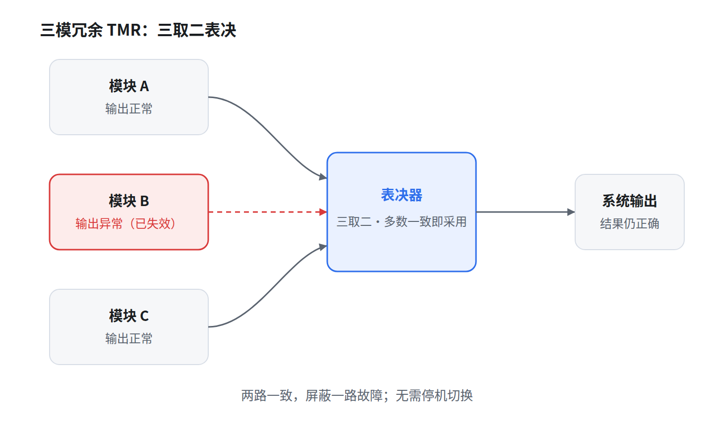

# 三模冗余与多模冗余

## 一、三模冗余 TMR

三模冗余（Triple Modular Redundancy，TMR）是最常用的静态冗余结构。它用三个功能相同的模块并行执行同一任务，把三路输出送入一个表决器，由表决器按「三取二」（多数一致）的规则决定最终输出。



**工作机制**

1. 三个模块同时接收相同输入，各自独立计算。
2. 表决器比较三路输出，取至少两路相同的那一路作为系统输出。
3. 若一个模块故障，另两个模块输出一致，结果仍然正确。故障被当场屏蔽，系统不停机、不切换。

**成立前提**

- 三个模块的故障相互独立。若三路同时受同一因素影响（共模故障），多数表决会一起出错。
- 表决器本身必须可靠。表决器是单点，通常需要自校验或双重结构。
- 单模块可靠度 R 必须大于 0.5，冗余才有正收益。

**与双模的区别**：双模冗余只能发现两路输出不一致，不能判定谁对；三模冗余通过「二对一」的比较，既能发现故障，又能定位并屏蔽故障。

**代价**：三倍硬件、三倍功耗与面积，以及表决器引入的额外延迟。

## 二、多模冗余 NMR

多模冗余（N-Modular Redundancy，NMR）是 TMR 的一般化：用 N 个模块并行工作，按多数表决输出。

- 系统能容忍的故障模块数 k = ⌊(N − 1) / 2⌋。
- N 必须为奇数。5 模容忍 2 个故障，7 模容忍 3 个故障。
- 偶数模（如 4 模）在出现 2 票对 2 票时无法裁决，只能检测不一致，不能纠正。

| 模数 N | 可容忍故障数 | 说明 |
|---|---|---|
| 1 | 0 | 无冗余 |
| 2 | 0 | 只能检测，不能纠正 |
| 3 | 1 | 经典 TMR，三取二 |
| 5 | 2 | 5 取 3 |
| 7 | 3 | 7 取 4 |

## 三、可靠性计算

设单模块可靠度为 R，表决器视为理想（可靠度 1）。系统正常工作，等价于故障模块数不超过 k：

```
R_NMR = Σ(k = 0 → ⌊(N-1)/2⌋) C(N,k) · R^(N−k) · (1−R)^k
```

TMR 展开为：

```
R_TMR = R³ + 3R²(1−R) = 3R² − 2R³
```

取单模块 R = 0.99 对比：

| 方案 | 容忍故障数 | 系统可靠度 |
|---|---|---|
| 单模 | 0 | 0.99 |
| 双模 | 只能检测 | 无法自动纠正 |
| TMR | 1 | 0.999702 |
| 5MR | 2 | 0.999990 |

核算过程：

- TMR：3 × 0.99² − 2 × 0.99³ = 2.9403 − 1.940598 = 0.999702
- 5MR：0.99⁵ + 5 × 0.99⁴ × 0.01 + 10 × 0.99³ × 0.01² = 0.950990 + 0.048030 + 0.000970 = 0.999990

两个结论：

1. 只有 R > 0.5 时冗余才划算。R = 0.5 时 R_TMR 仍是 0.5，与单模持平；R < 0.5 时冗余反而更差。
2. 收益递减。单模到 TMR 提升约两个数量级，TMR 到 5MR 只再提升约一个数量级，而硬件从 3 倍涨到 5 倍。

## 四、失效场景与考点辨析

**共模故障**：多路同时受同一因素影响，例如同批次器件、同路电源、同一软件缺陷。此时多数表决会一起出错，冗余失效。对策是异构冗余，即不同厂商、不同算法、不同实现。

**表决器单点**：三路都对，表决器错，系统仍错。表决器需自校验或双重结构，否则它成为新的单点故障。

**静态冗余与动态冗余**：TMR 属静态冗余，故障被屏蔽，无需切换，输出连续；双机热备属动态冗余，先检测故障再切换，切换期间有中断。

**冗余的四种形式**：

| 形式 | 做法 | 典型例子 |
|---|---|---|
| 硬件冗余 | 增加相同或相似的硬件 | TMR、双机热备 |
| 软件冗余 | 多个独立版本并行运行 | N 版本编程 |
| 信息冗余 | 增加校验信息 | 校验码、纠错码 |
| 时间冗余 | 重复执行 | 指令重试、事务重做 |

**常见辨析点**：

- 双模冗余不是「二取一」，而是「不一致就报警」，不具备自动纠正能力。
- N 取多数的容忍故障数是 ⌊(N−1)/2⌋，不是 ⌈N/2⌉，也不是 N−1。
- 冗余提升的是可靠度，不是单个模块的可靠度。若单模块 R ≤ 0.5，加冗余无意义。
- 表决器可靠度未计入公式时得到的是理想值，实际系统可靠度低于表中数值。

## 五、小结

TMR 用空间换可靠性：三个模块并行，表决器三取二，一个模块坏了结果照样正确。双模只能发现异常，三模才能掩盖异常，N 模是成本与可靠度之间的边际权衡。使用时必须守住两个前提：故障独立、表决器可靠。
