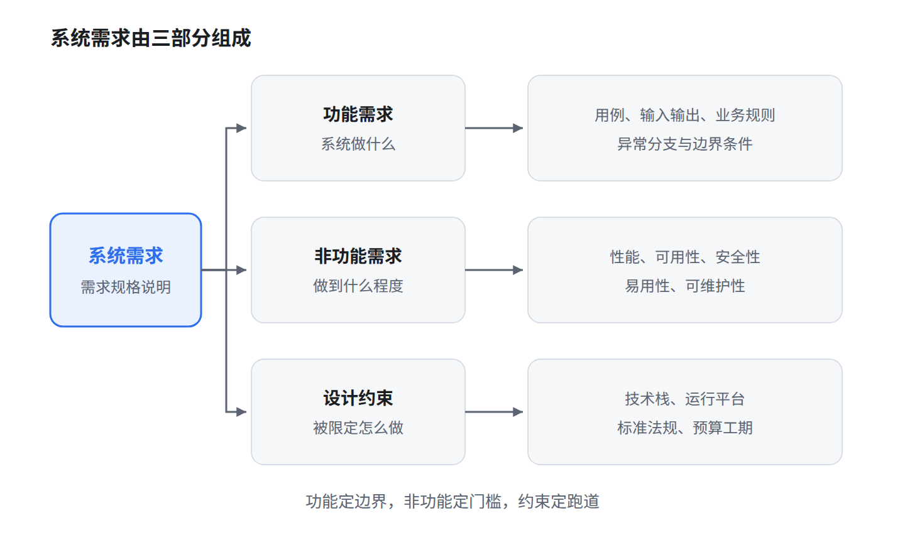

# 系统需求

系统需求是对目标系统必须满足的事项的完整描述。工程上把它分成三类：功能需求、非功能需求、设计约束。分类的目的不是归档，而是让每一条需求都能被验证、被追踪、被分配到设计。

## 一、三类需求的划分依据

| 类别 | 回答的问题 | 描述对象 | 判断落点 |
|---|---|---|---|
| 功能需求 | 系统做什么 | 外部可观察的行为 | 用例、验收测试 |
| 非功能需求 | 做到什么程度 | 质量属性与指标 | 度量、压测、评审 |
| 设计约束 | 被限定用什么方式做 | 方案空间的边界 | 架构决策、合规检查 |

一句话区分：功能需求定边界，非功能需求定门槛，设计约束定跑道。

## 二、功能需求

功能需求描述系统应提供的功能，包括输入、处理逻辑、输出、业务规则和异常处理。它只描述外部可观察的行为，不描述内部实现。

写法上，主语是系统，动词要明确，并带上触发条件与结果。

- 系统应支持按订单号查询订单状态，并返回当前节点与预计完成时间。
- 系统应在支付成功后 5 秒内生成发货单，失败时进入待人工处理队列。

判断标准：一条功能需求应当能写成一个用例或一个功能点，能通过界面操作或接口调用观察到结果。如果一条需求写的是「内部采用什么算法」，它就不是功能需求。

最常见的缺陷是只写主流程，漏掉异常分支与边界条件，例如超时、重复提交、并发冲突、权限不足。用例中的扩展流正是补这些的地方。

## 三、非功能需求

非功能需求描述系统的质量属性，包括性能、可靠性、可用性、安全性、易用性、可维护性、可移植性、可扩展性、容量与资源占用。它通常横切多个功能，难以分配给单个功能点，却往往决定架构。

非功能需求必须可度量，写法是「指标 + 条件 + 对象」。

| 属性 | 可验证的写法 | 不可验证的写法 |
|---|---|---|
| 性能 | 500 并发下，订单查询的 95 分位响应时间不超过 2 秒 | 系统响应要快 |
| 可用性 | 年可用率不低于 99.9%，即年停机不超过 8.76 小时 | 系统要稳定 |
| 安全性 | 敏感字段传输与存储均加密，口令不可逆存储 | 系统要安全 |
| 易用性 | 新用户无需培训，5 分钟内完成首次下单 | 界面要友好 |

可用性换算可以直接背：99.9% 对应年停机 8.76 小时，99.99% 对应 52.6 分钟，99.999% 对应 5.26 分钟。

## 四、设计约束

设计约束是预先给定、通常不可协商的限制。它不描述系统要做什么，而是规定方案必须落在什么范围内。常见来源：

- 客户指定的技术栈、中间件、数据库。
- 既有系统的接口协议、数据格式、遗留平台。
- 运行环境，如操作系统、浏览器版本、国产化软硬件平台。
- 行业标准与法规，如等级保护、密码合规、行业监管要求。
- 硬件条件、预算、工期、组织内的技术规范。

示例：「系统必须部署在信创服务器上，数据库使用国产关系型数据库」「必须复用集团统一身份认证」「必须满足等级保护三级要求」。

设计约束要在架构设计阶段显式转化为架构决策与检查项。否则它不会在编码阶段暴露，只会在验收阶段变成返工。

## 五、辨析与常见错判

| 表述 | 实际类别 | 理由 |
|---|---|---|
| 系统应提供操作日志审计功能 | 功能需求 | 描述一项可观察的功能，不是质量属性 |
| 系统应支持 1000 个并发用户 | 非功能需求 | 容量指标，可度量 |
| 系统应使用 MySQL 8.0 | 设计约束 | 指定实现技术，属外部限定 |
| 系统须通过等级保护三级测评 | 设计约束 | 外部标准限定 |
| 系统应在 3 秒内返回查询结果 | 非功能需求 | 性能指标 |

另外两点容易混：

- 外部接口需求（用户接口、硬件接口、软件接口、通信接口）在需求规格说明中常单列一类，也可并入功能需求。它描述系统对外交互，与限制实现方式的设计约束不同。
- 「系统应便于扩展」不是需求，是愿望。要写成「新增一种支付渠道的改动量不超过 2 人日，且不修改订单核心流程」，才具备可验证性。

## 六、小结

功能需求定边界，非功能需求定门槛，设计约束定跑道。三类都要可验证：功能靠用例与验收测试，非功能靠指标与压测，约束靠架构评审与合规检查。写需求时先问一句「这条怎么验收」，答不上来的条目就还没写完。
